<h1 align="center">Platinum Weather Card Plus Charts</h1>

**Everything about the weather, on one card:** now, the next hours and the days ahead, with charts; severe-weather warnings and lightning as they come; and a forecast of its own, read from your barometer. Start with a single weather entity and add your station's sensors as you go. In fifteen languages.

It started as a mashup of [Platinum Weather Card](https://github.com/tommyjlong/platinum-weather-card) and [Weather Chart Card](https://github.com/mlamberts78/weather-chart-card) — two of the best weather cards for Home Assistant, neither of which has seen active development for a while. I used to run Weather Chart Card on my main dashboard and Platinum on a dedicated weather view. At some point it felt pointless to maintain two separate cards with overlapping functionality, so I merged them as far as makes sense.

Based on the original Platinum Weather Card by [@makin-things](https://www.github.com/makin-things), extended by [@tommyjlong](https://github.com/tommyjlong). Weather Chart Card by [@mlamberts78](https://github.com/mlamberts78). Maintained and further developed here by me, [@rudizl](https://github.com/rudizl). If you like my work, you can <a href="https://buymeacoffee.com/rudizl"></a> and/or [drop a ⭐ on GitHub](https://github.com/rudizl/platinum-weather-card-plus-charts).

[](https://github.com/hacs/default)
[![GitHub Release][releases-shield]][releases]
[](https://github.com/rudizl/platinum-weather-card-plus-charts/releases)


[![License][license-shield]](https://github.com/rudizl/platinum-weather-card-plus-charts/blob/master/LICENSE)
[](https://github.com/rudizl/platinum-weather-card-plus-charts/actions/workflows/build.yml)

<p align="center">
  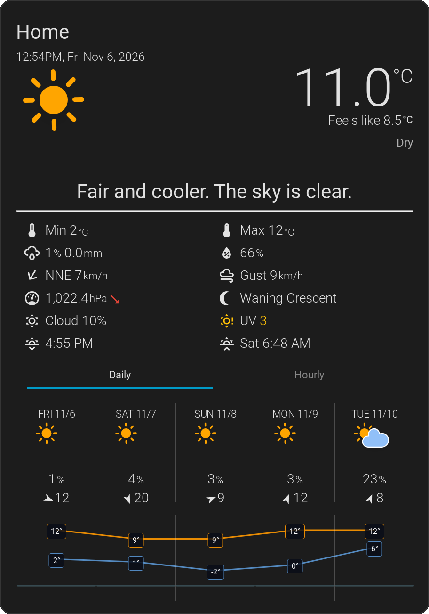
  &nbsp;&nbsp;
  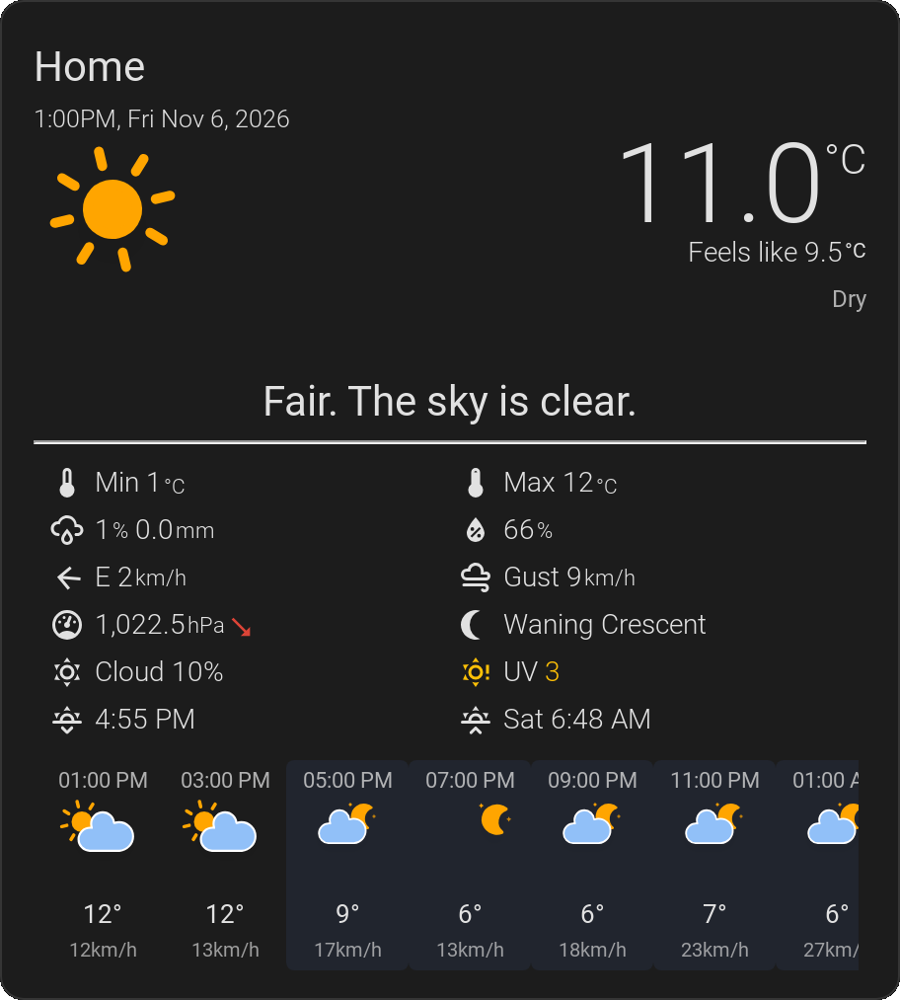
</p>

## What the card shows

- **The weather now**: the temperature, how it feels and a word for the air, and up to sixteen slots: wind and gusts, pressure and its trend, humidity, rain today and the rain rate, UV, cloud cover, the moon, the sun. From a weather entity, from your own station, or both.
- **Days and hours**: a daily forecast (in columns or in rows) and an hourly one, in tabs, with temperature and rain charts and a tooltip for each day. The hours show the chance of rain and the wind, with the night shaded and a moon after dark. A twice-daily forecast (the US National Weather Service) fills both.
- **Warnings, without another card**: severe-weather warnings from MeteoAlarm or any feed with the same CAP attributes, in fifteen kinds, yellow, orange or red, with the time they end, in the card's language, and both hazards when one warning names two. And a row for **lightning** from Blitzortung (no hardware needed) or a strike detector, with its distance and direction.
- **A forecast from your barometer**: Sager, which reads the wind and the sky as well, or Zambretti, short or in full.
- **The sky from a pyranometer**: a measured cloud cover corrects the provider's icon by day.
- **Icon packs**: the built-in animated set, Meteocons (line or fill), the icons of Home Assistant, or your own pictures.
- **Fifteen languages**, light and dark themes, the sections view, *Add to dashboard → By entity*, and an editor whose lists offer only the sensors that fit each field.

<p align="center">
  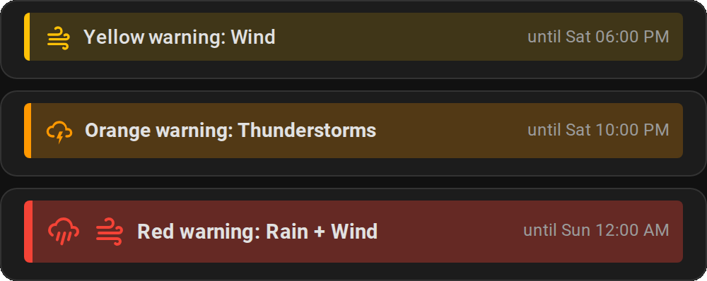
</p>
<p align="center">
  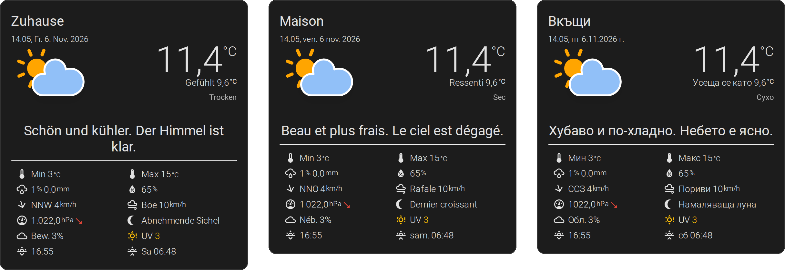
</p>

## Installation

The card is in the default catalogue of HACS, which from Home Assistant 2026.11 is built in and called the **Marketplace**. A card installed through HACS stays installed when you upgrade.

[](https://my.home-assistant.io/redirect/hacs_repository/?owner=rudizl&repository=platinum-weather-card-plus-charts&category=plugin)

1. **Settings → Marketplace** (on Home Assistant 2026.10 and older, HACS) → search for **Platinum Weather Card Plus Charts**, or use the button above
2. **Download**. The card is added to your dashboard resources for you
3. Hard-refresh your browser
4. Add the card to a dashboard. In *Add to dashboard*, pick a weather entity under *By entity* and the card is offered under *Community*, already set up for it (Home Assistant 2026.6 or later); under *By card* it has a preview, filled in with one of your weather entities. Or in YAML:

   ```yaml
   type: custom:platinum-weather-card-plus-charts
   weather_entity: weather.home
   section_order: [overview, slots, daily_forecast, charts]
   show_section_charts: true
   option_show_temperature_chart: true
   option_show_precipitation_chart: true
   ```

<p align="center">
  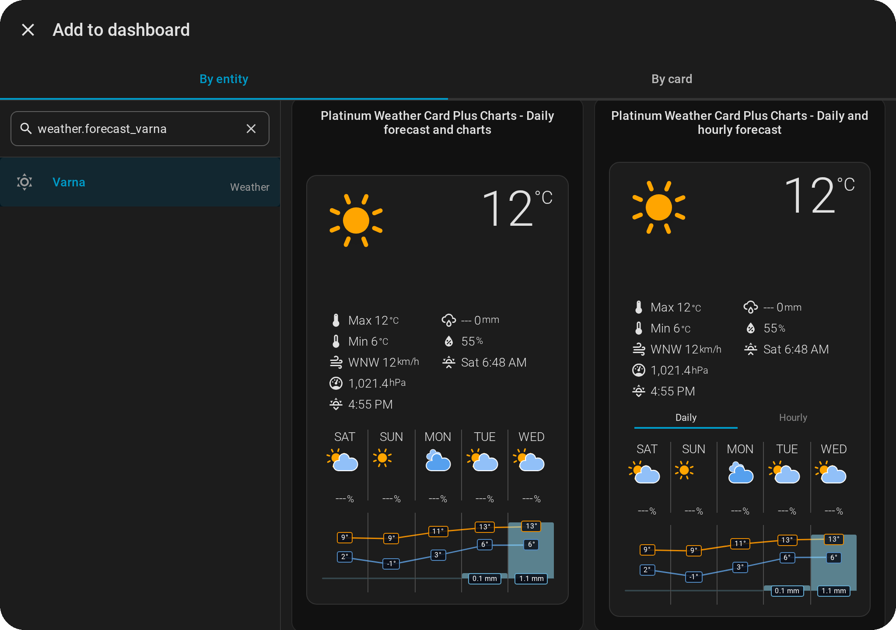
</p>

**Betas.** On the card's page in the Marketplace, the ⋮ menu has **Include pre-releases**, after which the update offers the newest beta, and **Install another version**, to install a beta or to go back to the stable one. **Reinstall** downloads the installed version again. In HACS the same is ⋮ → **Redownload**, where you choose the version.

### With just a weather entity

A card with a `weather_entity` and nothing else to read works. The overview, the slots, the days and the charts all take their figures from it: temperature, feels-like, humidity, pressure, wind and gusts, visibility, UV index, cloud cover, today's high and low, and today's chance of rain and rain amount from its attributes and forecast, the dew point for the comfort word (with the comfort option on), the condition icon from its state, and the days from its forecast. What a provider does not give shows as `---`, and the feels-like line is left out.

<p align="center">
  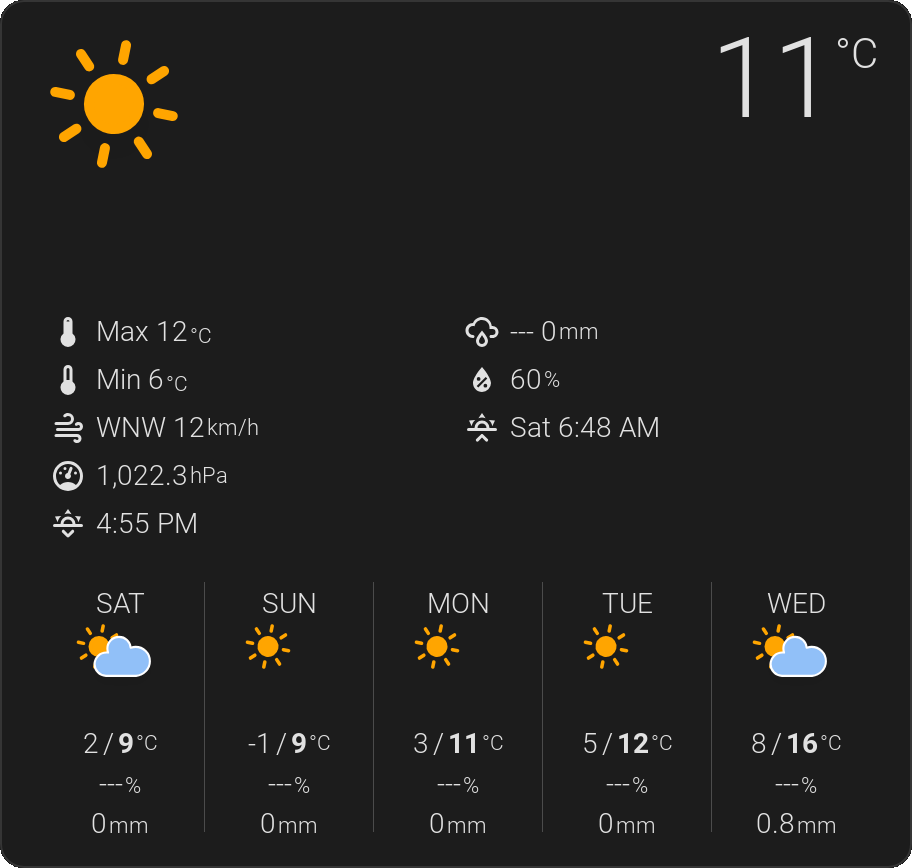
</p>

Add sensors and they are your choice, one group at a time. Set any one of the measurement settings (`entity_temperature`, `entity_humidity` and the rest, listed on the `weather_entity` row of the YAML reference) and none of the others is filled in for you; the same goes for the six per-day settings (`entity_forecast_icon_1` and its siblings). So a weather station beside a forecast stays exactly what you made it. None of this is written to your configuration.

No weather entity yet? [Met.no](https://www.home-assistant.io/integrations/met/) is built into Home Assistant and gives one for your home, with daily and hourly forecasts:

[](https://my.home-assistant.io/redirect/config_flow_start/?domain=met)

### Coming from the original Platinum Weather Card?

If you used [Platinum Weather Card](https://github.com/tommyjlong/platinum-weather-card), your configuration carries over: every option and slot name from its documentation is supported here, including the per-day `entity_forecast_*_1` sensors, so the card works without a weather entity, charts included: they are drawn from those sensors.

1. Install this card from the Marketplace (or HACS), as above.
2. In your card's YAML, change `type: custom:platinum-weather-card` to `type: custom:platinum-weather-card-plus-charts`.
3. Hard-refresh. The charts and the hourly forecast are extra sections you can switch on in the editor.

The two cards register under different names, so you can try this one beside the old one and switch over card by card.

---

## What's new in 2.7.0

2.7.0 is in beta. It is everything of 2.6.0, and:

- **Weather effects** (experimental): behind the top of the card, or the whole of it, clouds drift with the wind, rain and snow fall, stars come out on a clear night, fog rolls in and a storm flashes. They follow the icon the card settles on, after the rain gauge and the pyranometer have had their say. Off unless you turn them on, and still when your device asks for less motion.
- **The `photoreal` icon pack**: twenty-five pictures, bundled with the card, with skies drawn for the cloud cover that a pyranometer measures.
- **Soft warnings**, the new default: the row is a stripe in the colour of the level that fades out, and a storm far away is a small pill instead of a row. The classic flat bar is still there.
- Every version since 2.0.0, by what was added, what changed and what was fixed, is in the **[full changelog](https://github.com/rudizl/platinum-weather-card-plus-charts/blob/master/CHANGELOG.md)**.

---

# Sections

<p align="center">
  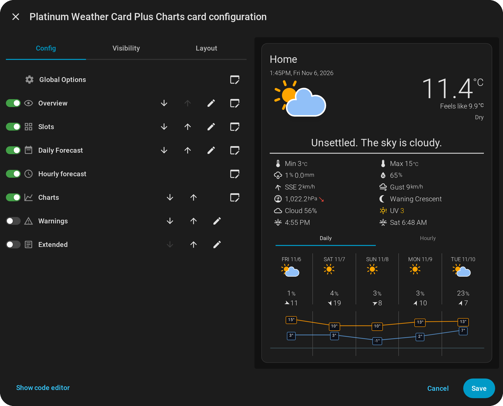
</p>

- **Warnings** — weather alerts from a MeteoAlarm-compatible sensor
- **Overview** — the condition icon, temperature and forecast text
- **Extended** — a longer forecast description
- **Slots** — two columns of readings, up to eight each
- **Daily Forecast** — a column per day
- **Hourly Forecast** — a column per hour, as a tab beside the days or on its own
- **Charts** — temperature lines and precipitation bars

Each row has a switch to hide the section entirely and arrows to reorder it. The pencil opens the entities the section reads from; the second icon, where present, opens its display options. **Hourly Forecast** is the exception: it is a view of the daily forecast rather than a section, so it has a switch and one settings button, holding both its entity and its options, and no arrows.

**Global Options** and **Appearance** at the top are not sections of the card. Global Options holds the settings that several sections draw on, such as the locale and the station sensors; Appearance holds how the card looks: the icon pack, the static icons, how close the slots sit, and the weather effects.

## Overview Section

Four layout options are available:

| Layout | Preview |
|--------|---------| 
| **Complete** | 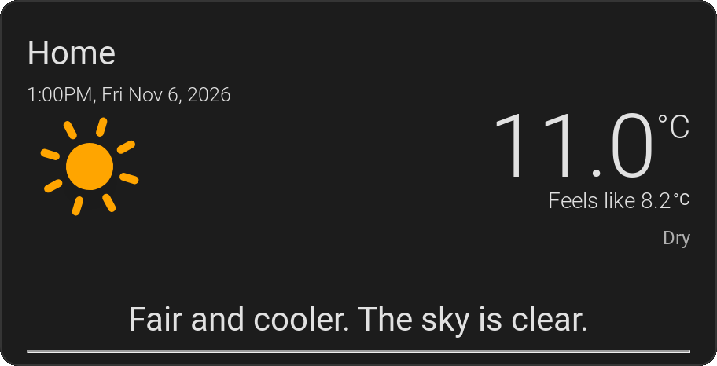 |
| **Observations** | 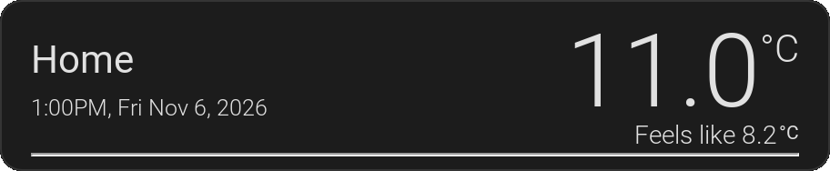 |
| **Forecast** | 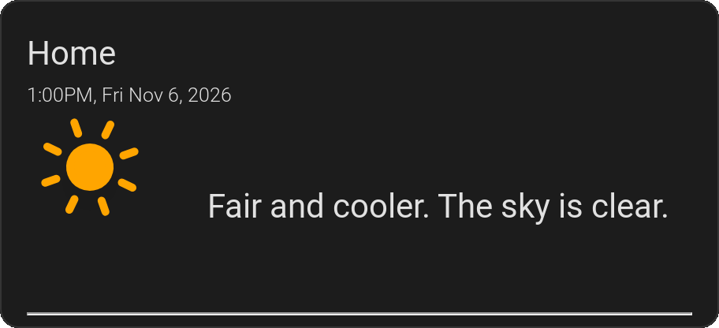 |
| **Title Only** | 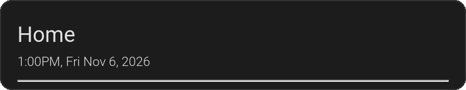 |

| Option | Type | Description |
| ------ | ---- | ----------- |
| Card Title Text Line 1 | String | Optional title line 1 |
| Card Title Text Line 2 | String | Optional title line 2 |
| Entity Update Time | Entity | Entity providing the timestamp (RFC 3339 format) |
| &nbsp;&nbsp;Use Attribute | Boolean | Use an attribute of the above entity for the timestamp |
| &nbsp;&nbsp;Attribute | String | The attribute containing the timestamp |
| Update Time Prefix | String | Text to prepend to the timestamp |
| Entity Current Temperature | Entity | Current temperature |
| Entity Apparent Temperature | Entity | Apparent / feels-like temperature |
| Entity Forecast Icon | Entity | Entity whose state drives the condition icon |
| Entity Forecast Summary | Entity | Entity whose state is shown as the condition text |
| Show Temperature Decimals | Boolean | 1 decimal on current/apparent temperature |
| Show Separator | Boolean | Separator line below the overview section |
| Local forecast (Zambretti) | Boolean | Replace the summary text with a locally computed Zambretti forecast |
| &nbsp;&nbsp;Verbose forecast text | Boolean | Full-sentence forecast with a pressure-tendency clause |
| &nbsp;&nbsp;Station altitude (m) | Number | Only for absolute-pressure sensors — leave empty for relative/sea-level |

Wind bearing sensors may report either numeric degrees or compass text. Both Latin (`NW`, `SSE`) and Cyrillic (`СЗ`, `ЮЮИ`, and the Russian/Ukrainian `В` for east) abbreviations are recognised — some providers return them localized, or mixed in with the Latin ones.

### Tap on a value → history

Tapping a slot value (humidity, pressure, wind, ...) — or the big current temperature and the apparent temperature below it — opens the native more-info dialog with the history/statistics graph. Only slots backed by a real sensor are tappable — a pointer cursor and a subtle hover highlight show where. Slots reading attributes of a `weather.*` entity stay inert (their dialog would show a forecast, not history). The card-level tap/hold actions are unaffected. Controlled by `option_slot_tap_more_info` (Slots section toggle, on by default).

### Local forecast (Zambretti)

The card can compute a short local forecast entirely from your own weather station — no internet, no forecast provider. It implements the classic **Zambretti forecaster** (Negretti & Zambra, 1915), which reads barometric pressure, its trend, wind direction and season. It is reported to be right around 90% of the time for the next 12 hours — but that figure comes from the frontal weather it was designed for, and there are conditions it cannot see at all (see *What it can and cannot do* below).

Enable it in the editor: **Overview Section → Options → Local forecast (Zambretti)**. When enabled, the computed forecast text replaces the `entity_summary` text in the overview section, localized to the card's configured language (one of 26 phrases, e.g. *"Fine weather"*, *"Unsettled, rain later"*, *"Stormy, much rain"*).

A **Verbose forecast text** toggle expands the short phrase into a full sentence with a pressure-tendency clause, e.g. *"Unsettled weather, with rain expected later. The pressure is falling."*

| Short | Verbose |
|-------|---------|
| 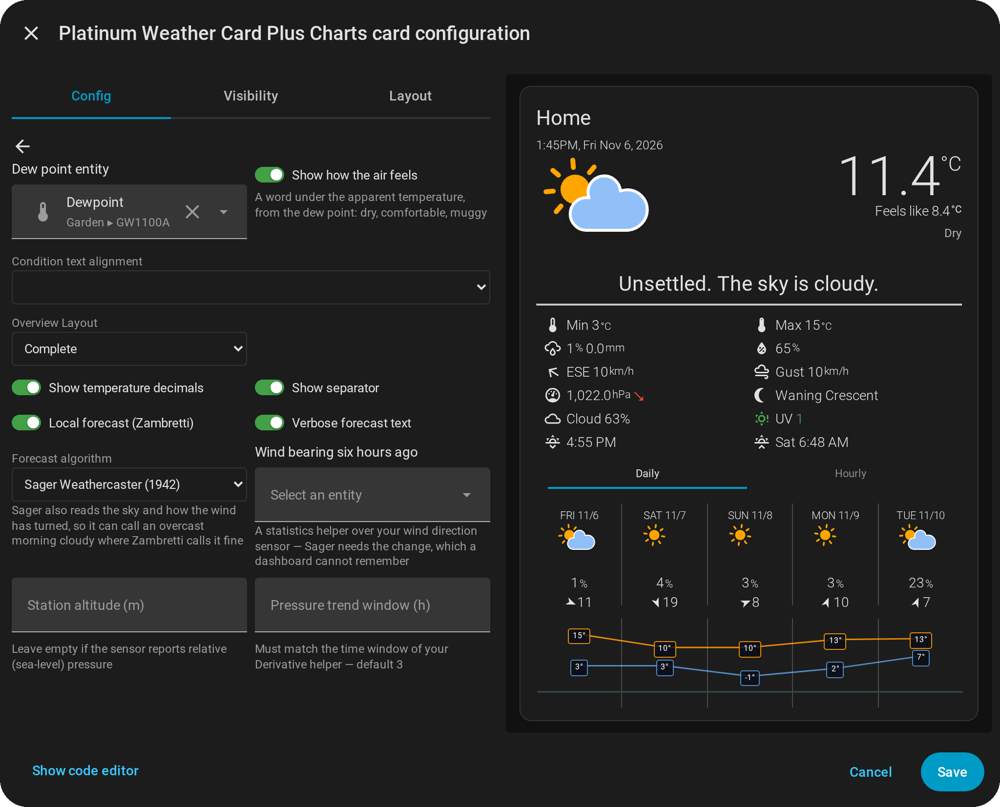 | 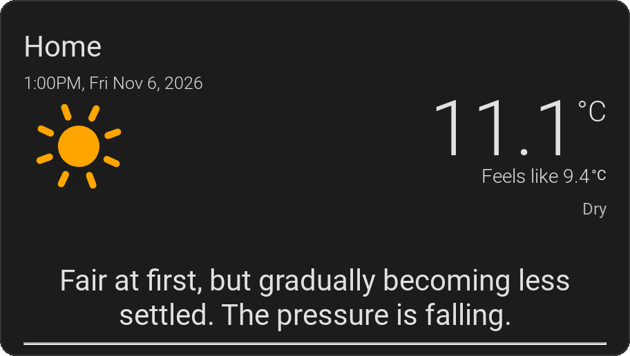 |

Inputs used:

- `entity_pressure` — **required.** Sea-level (relative) pressure preferred. Units are auto-converted from the sensor's `unit_of_measurement` (hPa/mbar, inHg, mmHg, kPa, psi, Pa).
- `entity_pressure_trend` — strongly recommended. A numeric derivative sensor in hPa/h gives the best result (±0.1 hPa/h is the rising/falling threshold); text states `rising`/`steady`/`falling` also work.
- `entity_wind_bearing` — optional, refines the forecast (degrees or compass text).
- **Station altitude** — only set this if your pressure sensor reports *absolute* (station) pressure; the card then applies the barometric sea-level correction using the current temperature. Leave empty for relative/sea-level sensors.

The hemisphere is detected automatically from your Home Assistant latitude.

#### The Sager Weathercaster

Zambretti's blindness to the sky is not fixable within Zambretti — but it is precisely what Raymond Sager set out to address in 1942. His instrument reads six things rather than three: pressure, its trend, the wind sector, **how the wind has turned over six hours**, the cloud cover, and whether it is raining. Choose it under **Forecast algorithm**.

The difference shows in the case that prompted this: a morning at 1020 hPa with the barometer rising and the sky two-thirds covered. Zambretti says *fine weather*, because that is what the barometer says. Sager says *unsettled*, because it can also see the cloud.

It needs one thing the card cannot supply itself. Sager compares the wind now with the wind six hours ago, and a dashboard forgets everything when the page reloads — so the history has to come from a helper you create:

[](https://my.home-assistant.io/redirect/config_flow_start/?domain=statistics)

```yaml
# Settings → Devices & Services → Helpers → Statistics
# Source: your wind direction sensor
# Characteristic: circular mean (mean_circular)
# Sampling size: enough to cover six hours
# Max age: 6 hours
```

Choose the **circular mean**, the one made for a direction. An ordinary mean of 350° and 10° is 180°, a south wind made of two northerly ones, where the circular mean says 0°; around north that turns the whole branch the wrong way. And a mean over six hours lies about three hours back, so the turn it shows is about half the turn of the full six hours: for telling a backing wind from a veering one, that is enough.

Point **Wind bearing six hours ago** at that helper. It is not required: without it the other five inputs still stand, and the sky measurement — the reason to choose Sager at all — is worth more than the one branch the bearing sharpens.

That branch is a backing wind under a falling barometer, which is the classic signature of a warm front arriving. Worth knowing before you rely on it at a coastal site: a sea breeze turns the wind through the same angles every day regardless of the weather, so the signal is noisier there than inland.

The forecasts are Sager's own, with his lettering (A through Y), so the output is comparable with any other implementation of the instrument. His wording is condensed for the card: *"Precipitation or showers/flurries followed by improvement (within 12 hours) and becoming cooler"* was written for a printed manual, not for a phone.

<details>
<summary>The twenty-one forecasts</summary>

| | |
| --- | --- |
| A | Fair |
| B | Fair and warmer |
| C | Fair and cooler |
| D | Unsettled |
| E | Unsettled and warmer |
| F | Unsettled and cooler |
| G | Increasing cloud, then precipitation |
| H | Increasing cloud, then precipitation; warmer |
| J | Showers |
| K | Showers and warmer |
| L | Showers and cooler |
| M | Precipitation |
| N | Precipitation and warmer |
| P | Precipitation, turning cooler; improving within 24 hours |
| R | Precipitation, improving within 12 hours |
| S | Precipitation, improving within 12 hours; cooler |
| T | Precipitation, improving within 6 hours |
| U | Precipitation, improving within 6 hours; cooler |
| W | Precipitation, then fair within 6 hours; cooler |
| X | Unsettled, then fair |
| Y | Unsettled, then fair within 6 hours; cooler |

Every one of them is reachable, which the tests assert — a phrase translated into fourteen languages that no combination of inputs can produce would be fourteen translations wasted.

</details>

In verbose mode a wind clause and a temperature clause follow, but only when they have something to say: *no important change* is Sager's commonest outcome for both, and a line spent reporting that nothing is happening is a line wasted. Several of his forecasts already carry the temperature in their own wording, and the clause is suppressed for those rather than repeating it.

The quadrants mirror south of the equator, since the circulation does — but east stays east, because ahead of a depression the air arrives from the east in both hemispheres.

#### How well it actually does

Measured against a station on the Bulgarian coast over six weeks, because a forecast algorithm that has not been checked against what happened is a decoration.

**Summer convection — where it earns its place.** Of four rain events, three were warned an hour ahead and there were no false alarms at all: the ten hours it called wet were the ten hours it rained. Through all four the barometer said nothing — it was steady or *rising* each time, so a purely barometric forecast read *fine weather* throughout. The whole signal came from the sky: cloud went from 31% to 81% in the hour before the first one.

**Frontal rain — where it does not.** A nine-hour front with an 18 mm/h peak arrived at six in the morning and Sager gave no warning whatever. Three separate reasons, and none of them fixable here:

- the rain arrived before dawn, when a pyranometer can see nothing at all
- the barometer dipped gently and then rose through the entire event
- the wind veered south to north — a *cold* front, where rain falls at the boundary, while Sager's frontal branch is tuned for a warm one, where it falls ahead

A lightning detector covering 100 km recorded no strikes that day, which independently confirms there was no convection to see. A numerical model had the event two days in advance.

The line between the two cases is worth stating plainly: **convection builds over you for hours, and local sensors watch it happen. A front is assembled somewhere else and arrives finished.** For the second kind, a forecast provider will beat any instrument in your garden, and no amount of tuning changes that.

Cloud cover comes from the pyranometer if you have one configured, and rain from the gauge. The forecast holds on to a shower for ninety minutes after it stops, since a dry gap in the middle of a convective spell is not fine weather — on one evening here it rained at eight, stopped for two hours and resumed at eleven, and in the gap the forecast read *fair*. The rain rate slot is unaffected and still reports what the gauge says this minute. Without a pyranometer Sager still works, assuming partly cloudy — it simply loses the advantage that made it worth choosing.

After dark a pyranometer says nothing, which is precisely when that advantage would go missing, so the forecast falls back to the last reading taken in daylight — for six hours. That reaches from dusk into the small hours, where a stale figure is still roughly true. Longer than that it stops being information: on one frontal night here the sky was last measured at 38% on the Saturday afternoon, and by the time rain arrived at six the next morning it had reached 84%, with the old figure still being reported throughout. The cloud cover **slot** is unaffected and still shows `---` at night, since it reports a measurement rather than a forecast input.

When the card has neither a measurement nor a reading from the last six hours, it asks the provider: first the entity named under **Cloud cover entity (night fallback)** (`entity_cloud_cover`), read as the slot reads it, the attribute `cloud_coverage` of a weather entity or the state of a sensor, in per cent; and when none is named, or it gives no number, a weather entity that gives `cloud_coverage` (met.no does), the entity of the hourly forecast first and then the card's own weather entity. A blind forecast is the one to avoid: on 26 October at 21:11 Sager said *fair and cooler* under a sky that met.no gave as 99% covered, and it is *unsettled*, with the sky named, when it can read it. What the card measured, now or in the last six hours, always comes first, and an entity that gives no number leaves the sky unknown as it was. The slot is unaffected here too.

#### What it can and cannot do

Zambretti is **purely barometric**. It infers the weather from the pressure level, which way the pressure is moving, and where the wind is coming from. That works because in the mid-latitude frontal weather it was built for — Britain in 1915 — pressure genuinely leads the weather: fronts announce themselves in the barometer hours before they arrive.

It follows that the algorithm is blind to anything that does not move the barometer:

- **Summer convective storms.** Thunderstorms often form under high pressure with no barometric signature whatsoever. The card can read *"fine weather"* while a storm is building overhead, and it is not wrong about the pressure — it simply has no way to see instability, moisture or lift. In a convective climate, treat the local forecast as one input among several rather than the authority.
- **Fog, frost, and anything driven by radiation or humidity.** No input, no output.
- **Terrain effects.** Sea breezes, valley winds, lake effect — all invisible to it.

Where it does well is the thing your forecast provider is often slowest on: a front arriving earlier or later than the model said. The barometer at your own location knows before the model updates.

None of this is fixable within Zambretti; the missing input is cloud cover, which is what later algorithms use alongside pressure and wind change. That is exactly what [the Sager Weathercaster](#the-sager-weathercaster) below does, and why it is offered as an alternative rather than as a setting on this one — it is a different instrument, not a tweak.

> **Your pressure sensor must report sea-level (relative) pressure — check this first.**
> Zambretti reads the absolute pressure level, so an uncalibrated station throws the forecast off by several categories, permanently. A station at 150 m altitude reads roughly 18 hPa below sea level: the algorithm sees 1002 hPa ("changeable, some rain") when the real sea-level pressure is 1020 hPa ("settled fair"), and the card then predicts rain on a cloudless day.
>
> **Ten-second check:** compare your absolute and relative pressure sensors. If they read *exactly* the same, the station is not applying any correction and you are feeding the card raw station pressure.
>
> Fix it in **one** of these two places, never both:
>
> - **In the station (recommended)** — Ecowitt/WSView Plus → Calibration → **Altitude for REL** (leave *Abs Offset* at 0.0, that field corrects the absolute reading, which is already right). This also fixes what the station uploads to Weather Underground and the like.
>
>   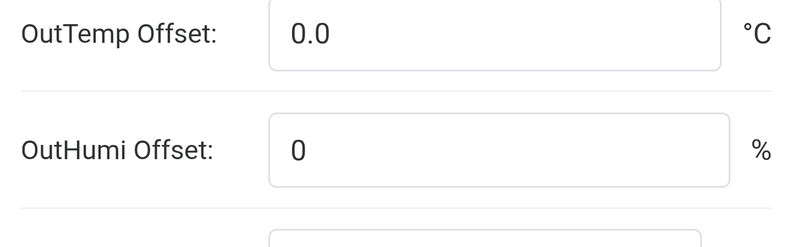
>
> - **In the card** — fill the *Station altitude (m)* field, and the card applies the barometric correction itself using the current temperature.
>
> To verify, compare the corrected value with the QNH from a nearby airport METAR — they should agree within a hPa or two.

To keep the text stable and honest about its inputs, the card applies three rules:

- **Wind direction is used only when it means something** — the reading is dropped below 8 km/h, and also whenever the bearing has been wandering over the last 15 minutes (measured as circular concentration, R < 0.7). A vane in light air sweeps the whole compass; professional stations report `VRB` for the same reason, and aviation reports state a range such as `040V120` — an 80° spread at 9 knots. Since Zambretti applies up to ±8.35 hPa based on the bearing, an unsteady reading alone can move the forecast several categories.
- **The pressure trend is corrected for the atmospheric tide, then judged conservatively.** Pressure breathes twice a day — maxima near 10:00 and 22:00 local solar time, minima near 04:00 and 16:00 — with an amplitude of about 1.16·cos²(latitude) hPa. At 43°N that is a slope of up to 0.32 hPa/h, several times any sensible "falling" threshold, so an uncorrected forecast deteriorates every afternoon and recovers every morning regardless of the weather. The card subtracts the expected tide (computed from your latitude and longitude, averaged over the trend sensor's window) and then applies hysteresis: rising/falling starts at ±0.30 hPa/h — roughly 0.9 hPa over three hours, the scale the original algorithm was built around — and returns to steady below ±0.20. A changed phrase must also persist for five minutes before it replaces the one on screen.

  The tidal correction has to be averaged over the same window your trend sensor uses — at three hours versus one they differ by up to 0.16 hPa/h, over half the threshold for calling the pressure falling. A Derivative helper does not expose its window on the entity, so set **Pressure trend window** in the editor to match it. Default is 3 hours, which is both the Derivative default and the window the original Zambretti algorithm was built around.
- **The pressure-tendency clause is read live** from the same source as the pressure slot's arrow, so the sentence and the arrow can never contradict each other.

```yaml
type: custom:platinum-weather-card-plus-charts
entity_pressure: sensor.ws_relative_pressure
entity_pressure_trend: sensor.pressure_trend
entity_wind_bearing: sensor.ws_wind_direction
option_local_forecast: true
# option_forecast_altitude: 550   # only for absolute-pressure sensors
```

## Extended Section

Shows today's detailed forecast text.

Where several entities feed it, **Separate sources** puts each on its own line rather than running them into one paragraph — which matters because providers rarely end their text with a full stop, so without it two forecasts collide mid-sentence.

| Option | Type | Description |
| ------ | ---- | ----------- |
| Entity Extended Forecast | Entity | Entity providing the detailed forecast |
| &nbsp;&nbsp;Use Attribute | Boolean | Use an attribute of the entity instead of its state |
| &nbsp;&nbsp;Attribute | String | The attribute containing the forecast text |
| Entity Today's UV Forecast | String | Optional entity appended to the extended forecast |
| Entity Today's Fire Danger | String | Optional entity appended to the extended forecast |

## Slots Section

Each column holds up to eight slots, chosen from the list below and configured here:

<p align="center">
  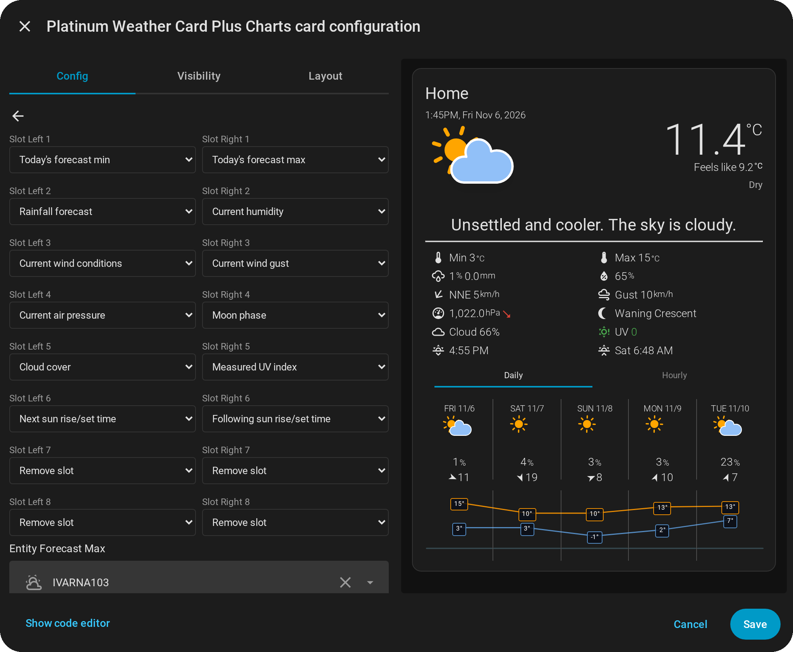
</p>

Up to 8 rows of data in 2 columns. The required entities update dynamically based on which slots are selected.

<p align="center">
  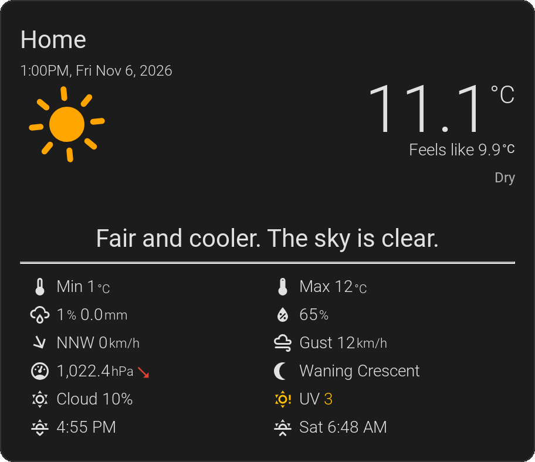
</p>

| Slot Value | Description | Example |
| ---------- | ----------- | ------- |
| `humidity` | Current humidity | 36% |
| `rainfall` | Today's recorded rainfall | 5mm |
| `rain_rate` | How hard it is raining now, coloured by intensity | Rate 1.2mm/h |
| `pressure` | Current air pressure | 1018hPa |
| `wind` | Wind direction, speed and gust | SSE 9km/h (Gust 13km/h) |
| `wind_kt` | Wind in knots | SSE 5Kt (Gust 6Kt) |
| `wind_gust` | Gust on its own, without the direction and mean | Gust 13km/h |
| `visibility` | Current visibility | 70km |
| `observed_max` | Today's observed maximum | Observed Max 19°C |
| `observed_min` | Today's observed minimum | Observed Min 4°C |
| `forecast_max` | Today's forecast maximum | Forecast Max 19°C |
| `forecast_min` | Today's forecast minimum | Forecast Min 1°C |
| `temp_next` | Next min or max | Overnight Min 4°C |
| `temp_following` | Following min or max | Tomorrow's Max 20°C |
| `temp_maximums` | Observed and forecast max | Obs Max 15°C (Fore 19°C) |
| `temp_minimums` | Observed and forecast min | Obs Min 13°C (Fore 1°C) |
| `sun_next` | Next sunrise or sunset | 7:10pm |
| `sun_following` | Following sunrise or sunset | Mon 6:35am |
| `moon` | Moon phase with dynamic icon and translated name | Растяща луна |
| `cloud_cover` | Cloud cover measured from a pyranometer, daylight only | Cloud 24% |
| `pop` | Chance of rain | 10% |
| `popforecast` | Rainfall forecast | 10% - 3 to 6mm |
| `possible_today` | Forecast rain today | Forecast 15-25mm |
| `possible_tomorrow` | Forecast rain tomorrow | Fore Tom 5-10mm |
| `uv_summary` | UV forecast, as the provider words it | UV High |
| `uv_index` | Measured UV index, coloured by the WHO exposure bands | UV 7 |
| `fire_danger` | Fire danger | Moderate |
| `custom1`–`custom4` | Custom entity with icon and unit | |
| `empty` | Blank slot (preserves space) | |
| `remove` | Remove slot entirely | |


### Pressure trend indicator

If you point `entity_pressure_trend` at a trend sensor, the pressure slot shows a small colored arrow next to the value: ↗ green (rising), → gray (steady), ↘ red (falling). Accepted sensor values: numeric rate of change (± beyond 0.05 counts as rising/falling) or the text states `rising` / `steady` / `falling`.

The easiest source is a **Derivative helper** (Settings → Devices & Services → Helpers → Create helper → Derivative):

[](https://my.home-assistant.io/redirect/config_flow_start/?domain=derivative)

- **Source:** your barometric pressure sensor
- **Time window:** 3 hours (the meteorological standard for pressure tendency)
- **Time unit:** hours (output becomes hPa/h)

Or in YAML:

```yaml
sensor:
  - platform: derivative
    source: sensor.your_pressure_sensor
    name: Pressure trend
    unit_time: h
    time_window: "03:00:00"
    round: 2
```

Then select it in the editor: Slots Section → *Entity Pressure Trend* (the picker appears once a pressure entity is set).

## Warnings Section

The card shows the warnings that would otherwise need cards of their own: a severe-weather warning from your national weather service, and a storm that is coming. The section is there while there is something to show, and gone the rest of the time.

<p align="center">
  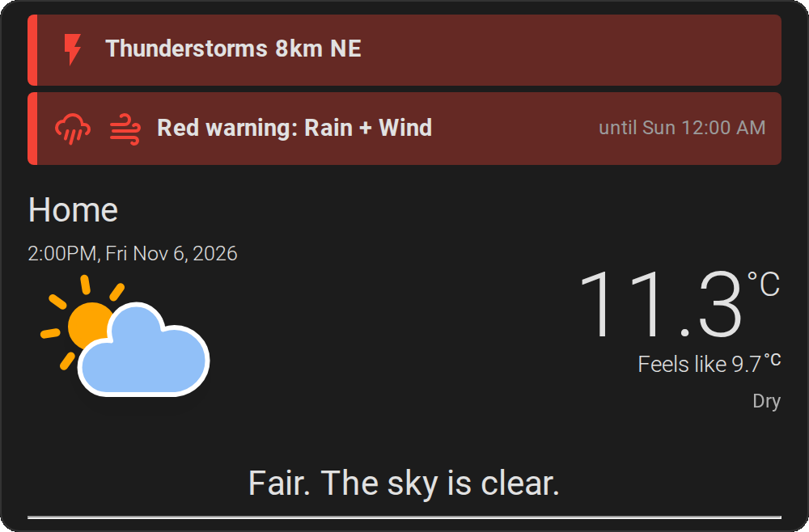
</p>

**Severe-weather warnings.** Point **Warning entity** at a [MeteoAlarm](https://www.home-assistant.io/integrations/meteoalarm/) binary sensor, or at any integration exposing the same CAP attributes. The wording is the card's own, in the card's language, rather than the provider's: MeteoAlarm reports the hazard as numbered strings following the EUMETNET CAP profile (`awareness_type: "5; high-temperature"`, `awareness_level: "2; yellow; Moderate"`), and the card keys off those numbers, so a warning reads the same in each of its fifteen languages. The colour of the row follows the level, yellow, orange or red, and the time the warning ends follows, in the card's locale.

<p align="center">
  
</p>

| Type | Hazard | Icon |
| --- | --- | --- |
| 1 | Wind | `mdi:weather-windy` |
| 2 | Snow and ice | `mdi:snowflake` |
| 3 | Thunderstorms | `mdi:weather-lightning` |
| 4 | Fog | `mdi:weather-fog` |
| 5 | High temperatures | `mdi:thermometer-high` |
| 6 | Low temperatures | `mdi:thermometer-low` |
| 7 | Coastal event | `mdi:waves` |
| 8 | Forest fire | `mdi:fire` |
| 9 | Avalanches | `mdi:image-filter-hdr` |
| 10 | Rain | `mdi:weather-pouring` |
| 11 | Flooding | `mdi:home-flood` |
| 12 | Flooding | `mdi:home-flood` |
| 13 | Rain and flooding | `mdi:home-flood` |
| 14 | Marine hazard | `mdi:sail-boat` |
| 15 | Drought | `mdi:water-off` |

When the title of a warning names a second hazard (`Heavy precipitation and strong wind!`, of the type rain), the row shows both, with an icon for each: see the note below.

**Lightning.** Point **Lightning distance entity** at a strike detector — [Blitzortung](https://github.com/mrk-its/homeassistant-blitzortung) is the usual one, and needs no hardware — and a storm within range gets a row of its own above any warning: `Thunderstorms 8 km NE`, with the direction when **Lightning azimuth entity** is set as well. The row is red within 15 km, orange to 30 km and yellow beyond, up to `option_lightning_max_distance` (50 km unless you set it); a storm further away is not shown.

[](https://my.home-assistant.io/redirect/hacs_repository/?owner=mrk-its&repository=homeassistant-blitzortung&category=integration)

**Soft or classic.** The warning rows come in two styles, chosen in the editor under **Appearance** or by `option_warning_style`. The soft style, the default, takes the colour out of the background: the row is a stripe on the left, in the colour of the level, that fades out to the right, and the icon has the colour too. A storm far away is not given a row at all: beyond 30 km it is a small pill with the distance and the direction, which takes almost no room, and from 30 km in it is a bar, and from 15 km in a bolder one. The classic style is the flat bar of a fixed tint with a hard edge on its left, as the card had it before.

This is deliberately part of the warnings section rather than a slot. An approaching storm is a warning in the same sense a rain alert is, and the section already appears and vanishes on its own, where a slot would sit empty most of the time — six weeks of readings at the station this was built against recorded no strikes at all. **Show expiry time** appends when it lifts; without it the row states the hazard alone.

| Option | Type | Description |
| ------ | ---- | ----------- |
| Warning entity | Entity | MeteoAlarm-compatible binary sensor |
| Show expiry time | Boolean | Append when the warning ends |

```yaml
type: custom:platinum-weather-card-plus-charts
section_order:
  - overview
  - warnings
  - slots
entity_warning: binary_sensor.meteoalarm_varna
```

> The MeteoAlarm integration reports only the first warning when several are active for the same region at once. That is a limitation of the integration rather than the card; a template sensor can work around it if you need every warning. [MeteoAlarm Plus](https://github.com/Tommixoft/meteoalarm_plus) (HACS; I have not tried it) says that it reads every warning and gives the most dangerous one on a binary sensor with the same attributes, which the card reads as it reads the built-in one.
>
> A service can also put **two hazards in one warning**: the warning of 2 November 2026 for Varna, from the national institute, was "Heavy precipitation and strong wind!", of the type `10; Rain`. The card names the hazards that the title of the warning says besides its type, and draws each with its own icon (at most two besides the type): *Red code: Rain + Wind*. It reads only the title (`event` and `headline`), never the description, and knows English and Bulgarian words; a title in another language is drawn by its type alone, as before.

### How the air feels

Under the apparent temperature the card can show a single word — *dry*, *comfortable*, *muggy* — worked out from the dew point. Point **Dew point entity** at your sensor in the overview options and switch on **Show how the air feels**.

Dew point rather than relative humidity, because relative humidity on its own says very little about comfort: 60% at 15°C is pleasant and 60% at 30°C is unbearable, since warm air holds far more water at the same percentage. Dew point is the actual moisture content, so its bands hold whatever the temperature is — a dew point of 21°C feels muggy at 24°C and at 35°C alike, because the moisture your sweat has to compete with is the same either way. That is why forecasters quote it and why it is the more useful number on a humid coast, where the temperature can look modest while the air does not.

The bands are the US National Weather Service ones:

| Dew point | | |
| --------- | - | - |
| below 10°C | below 50°F | Dry |
| 10–13°C | 50–55°F | Pleasant |
| 13–16°C | 55–60°F | Comfortable |
| 16–18°C | 60–65°F | Slightly humid |
| 18–21°C | 65–70°F | Humid |
| 21–24°C | 70–75°F | Muggy |
| above 24°C | above 75°F | Heavy air |

The Fahrenheit boundaries are the original ones, this being an American scale whose steps were chosen as round numbers there. The Celsius column is the conversion rounded to whole degrees, and it is what the card actually compares against — so a Fahrenheit reading within about half a degree of a boundary may fall on the other side of it.

### Cloud cover from a pyranometer

If your station measures solar radiation, the card can work out the cloud cover from it. How much sunlight *would* arrive under a clear sky depends only on the sun's elevation, the day of year and your altitude — pure geometry, no external data — so the ratio between that and what the sensor actually reports is the cloud cover.

Point **Solar radiation entity** in Global Options at your pyranometer (W/m²); a sun entity is needed too, since the calculation turns on the sun's elevation. The slot reads as a percentage by default; **Show oktas instead of percent** switches it to eighths of the sky, which is how observers and aviation reports state it. From there the measurement is available to two independent things: add the **Cloud cover** slot to show it as a reading, and switch on **Measurement corrects the icon** to let it correct the condition icon. Either without the other is fine.

Worth knowing about its limits:

- **Daylight only.** At night there is no signal at all. The slot falls back to a provider's cloud cover entity if you configure one, and shows `---` otherwise.
- **It stops below 10° of elevation**, where the air-mass model softens and morning haze distorts the reading, rather than reporting confident nonsense at dawn and dusk. The morning and evening cut-offs are set separately, under **Min sun elevation**, because obstructions rarely are symmetrical: a building to the west shades the late sun while the eastern horizon stays clear, and a single threshold then has to be set for the worse side. Five days of measurements here showed cloud reading 41% at six in the evening against 6% at noon, over a cloudless week — all of it the house.
- **The clear-sky model uses a fixed atmospheric transmittance**, so it reads a little high in hazy or dusty air and a little low in very clean air. Good enough to tell clear from overcast; not a radiometric instrument.
- **The sensor must be clean, level and unshaded.** A pyranometer that catches a roof edge each morning will report cloud that isn't there, every morning.

If your station has a rain gauge, point **Rain rate entity** at it too (mm/h). A gauge sees what neither a forecast provider nor a pyranometer can — whether it is raining here, now — and it takes precedence over both: rain reported by the gauge replaces a clear or cloudy icon, with the intensity following the rate. Rain starting is shown at once, because it is an event rather than a state to average; what is held is its end. A reading above zero counts as rain for fifteen minutes. Gauges that report in steps, such as the Ecowitt piezo gauge, which reads 0.6 mm/h, show light rain as short ticks with 0.0 between them, so a 0.0 does not prove that it has stopped, and without the hold the icon changed with every gap: about ten times in three hours on one evening of light showers. A gap of a few minutes is bridged; a lull of an hour is not. A gauge that drops out for a few seconds, as some stations do now and then, is held at its last reading for a minute. The rain rate slot goes on showing the truth throughout.

A weather entity that drops out for a moment, as some providers do at a fixed time every hour, keeps its last condition for ten seconds, so the icon does not flash.

The measurement can also correct the condition icon, under **Measurement corrects the icon**. The icon then follows the ordinary cloud bands — clear below 25%, lightly cloudy to 55%, cloudy to 85%, overcast above — rather than the provider's guess.

Only the plain sky icons are normally touched: rain, snow and fog are things a provider knows about and the sensors cannot see, so those are left alone. There are two exceptions, and they are not the same.

**Sunlit and dry.** Full sunshine on the pyranometer with a dry gauge rules out a thunderstorm overhead, whatever the forecast area as a whole is doing. A provider covers a region; a station covers a garden. Cloud has to be under 15% for this, which is deliberately demanding.

**A dry gauge against claimed rain.** When the provider says it is raining and the gauge says it is not, the gauge wins — whatever the sky is doing. A pyranometer cannot see rain, so cloud has no bearing on that claim; a gauge measures precisely the claim being made, and under an overcast sky it is the only instrument that can settle it. This is the commonest disagreement of all: grey, provider says rain, nothing falling. The icon then follows the measured cloud instead. When the sky cannot be measured — after dark, or with the sun under the elevation cut-off — there is no cloud to follow, and the icon shows plain overcast: rain means cloud, and it is the one thing the provider's own report supports.

It applies to rain only. A tipping bucket reads snow poorly and cannot see lightning at all, so snow, hail and storms stay with the provider. And it needs a gauge configured: with none, the provider stands, rather than an absent sensor being read as a dry one.

Off by default.

The measurement is shared by every card on the page — it describes the sky, not the card — so several cards never disagree about the same moment. Broken cloud swings the instantaneous reading violently — 181 to 513 W/m² inside three minutes on a typical morning, which spans the whole icon range — so the card takes the median of the last five minutes and the band boundaries carry hysteresis. The median rather than the mean because one reading through a gap should not drag the answer toward clear, and five minutes rather than longer because a window that includes a sunny spell from ten minutes ago describes the sky as it was, not as it is. Sun through a gap is still broken cloud, and an icon that changes every few minutes is worse than one that lags by a few.

The bands are the meteorological ones rather than wide safety margins. A sensor reading badly enough to matter is a sensor to clean, and treating it as untrustworthy while still displaying its number in a slot would be the worse of the two positions.

### Which icon the card shows

The provider supplies a condition, and the card draws it — but two things can overrule that, and both are about the card being able to see something the provider only predicts.

**The sun decides day or night.** Providers pick the day or night variant from their own forecast periods, and some switch to the night daypart in mid-afternoon: they report `clear-night` with the sun still 35° up, and the card would dutifully draw a moon. The **sun entity** decides — `sun.sun` unless you name another: the icon is the day variant from the moment Home Assistant's sun entity says `above_horizon`, the same instant the sunrise and sunset slots count from. If the state is anything else, the card falls back to the elevation, taking the sun as up above −0.83°, the horizon Home Assistant uses. This is on by default (**Day/night icon from sun**); switch it off to take the provider's word.

**The measurement can correct the condition itself.** That one is off by default and is described under [Cloud cover from a pyranometer](#cloud-cover-from-a-pyranometer) — briefly, a pyranometer and a rain gauge can contradict a forecast written hours ago for a region rather than a garden.

The two are independent: the sun override only changes day to night and back, never the weather, so it applies whatever else is switched on.

## Icon Packs

<p align="center">
  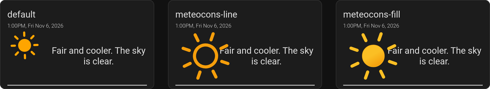
</p>

<p align="center">
  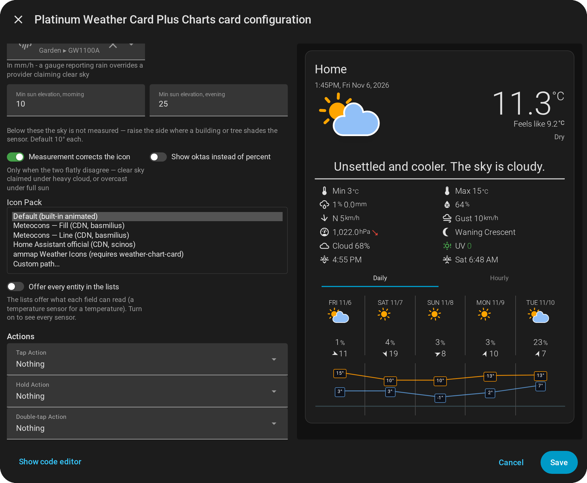
</p>

The card supports multiple icon packs, selectable from the editor's **Appearance → Icon Pack** dropdown (in earlier versions it was under Global Options).

| Value | Description | Requirement |
|---|---|---|
| `default` | Built-in animated SVG icons (bundled with the card) | None |
| `photoreal` | Photorealistic pictures: a real sun and moon, volumetric clouds, drops, snowflakes, hail, lightning (bundled with the card; experimental) | None |
| `meteocons-fill` | [Meteocons](https://github.com/basmilius/weather-icons) by Bas Milius — filled style | Internet (jsDelivr CDN) |
| `meteocons-line` | [Meteocons](https://github.com/basmilius/weather-icons) by Bas Milius — line style | Internet (jsDelivr CDN) |
| `wcc-2` | [ammap Weather Icons](https://www.amcharts.com/free-animated-svg-weather-icons/) — included in `rudizl/weather-chart-card` | Install `rudizl/weather-chart-card` via HACS |
| `ha-official` | [Home Assistant's own weather icons](https://github.com/scinos/lovelace-weather-icons) — the card then matches the rest of your dashboard rather than introducing a second style | Internet (jsDelivr CDN) |
| `custom` | Any icon set — set `icon_pack_path` with `{condition}` placeholder | User-provided |

> **Note:** `wcc-1` has been removed — it was byte-for-byte identical to the Meteocons Fill pack. Use `meteocons-fill` instead.

For `custom`, set `icon_pack_path` to a path template such as `/local/my-icons/{condition}.svg`. The `{condition}` placeholder is replaced with the HA weather condition name (e.g. `clear-day`, `partlycloudy`, `rain`).

### Third-party icon licenses

| Icon pack | Author | License |
|---|---|---|
| [basmilius/weather-icons](https://github.com/basmilius/weather-icons) (Meteocons) | [Bas Milius](https://bas.dev) | [MIT](https://github.com/basmilius/weather-icons/blob/master/LICENSE) |
| [scinos/lovelace-weather-icons](https://github.com/scinos/lovelace-weather-icons) (Home Assistant's official icons, `ha-official`) | [scinos](https://github.com/scinos) | [MIT](https://github.com/scinos/lovelace-weather-icons/blob/main/LICENSE) |
| [amCharts Weather Icons](https://www.amcharts.com/free-animated-svg-weather-icons/) (via `rudizl/weather-chart-card`, `wcc-2`) | amCharts / ammap.com | [CC BY 4.0](https://creativecommons.org/licenses/by/4.0/) — free including commercial use, attribution required |

> **Note:** The card's **default built-in icons** are also based on amCharts weather icons, extended by [@makin-things](https://github.com/Makin-Things/weather-icons).

**The `photoreal` pack.** The twenty-five pictures were generated with Google's Gemini by the card's author and cut out of their backgrounds by hand (the sun is drawn, not generated; a tropical storm, dust, the unknown name, the warning triangle and the question mark are made of the others and drawn; and the pictures of 25 to 55 per cent and of broken clouds are the pack's own sun and moon, with its stars, and streaks of cloud that Gemini drew across them, cut out of a green background); they are PNGs of 384 pixels with a transparent background, bundled with the card, 2 MB in all. The sun and the moon are single pictures, and the pictures of a sky with clouds are made of them and the set's cloud. The levels of the sky and of the rain look different: clear, a thin streak of cloud across the sun, partly cloudy (a sun with a cloud, for what a provider calls partly cloudy and for a forecast of it), broken clouds (a sun or a moon with two torn streaks of cloud in front, for a sky that the sensors measure at 55 to 85 per cent, with `option_cloud_overrides_icon`), a sun nearly hidden, and then plain cloud; a light rain, a rain and a pouring. The strange conditions have a picture each, and only one of them is alarming: *exceptional* (and a tornado or a hurricane) is a dark storm with lightning and a warning triangle, a tropical storm is heavy rain with wind, dust is a warm haze, and a name that the card does not know at all is a cloud with a question mark. The vortex that stood for all of them, and for any name that was new, is gone. (The `custom` pack asks for fifteen names only, and keeps them; for it a name that is not known is the plain cloud.) They are experimental: their licence terms are to be reviewed and settled before the next stable release, and until then the pack is part of the pre-releases only. They do not change colour with the theme, and the white ones (hail, snowflakes) are easy to lose on a white card.

## Weather effects (experimental)

```yaml
option_effects: subtle    # off, subtle or full
option_effects_area: overview    # overview or card
```

Behind the top part of the card, or the whole of it, the weather moves: clouds drift across at the speed of the wind, rain falls and slants with it, snow sways, stars come out on a clear night, fog rolls in and a storm flashes. It is off unless you ask for it. You can set it in the editor, under **Appearance**, next to the icon pack, or in YAML.

- **It draws a good deal of weather,** much of it worked out from what the card measures, since Home Assistant has no state for it. A reading that is not there simply leaves its effect out.

  | The weather | What you see | Worked out from |
  | --- | --- | --- |
  | Clear sky | a glow by day, stars at night | the icon |
  | Clouds | one to three, drifting at the pace of the wind | the icon, the pyranometer, the wind |
  | Rain | falling in three strengths, slanting with the wind as far as 45° | the icon, the rain gauge, the wind |
  | Freezing rain | icy streaks | rain, and a temperature of 0 °C or below |
  | Snow, sleet | flakes that sway; snow with rain in it | the icon |
  | **Blizzard** | snow flying nearly sideways, faster and thicker, and a whiteout | snow, and a wind of force 6 or more (and how far one can see) |
  | Hail | white pellets | the icon |
  | Storm | a dark sky, and flashes | the icon, and a lightning detector |
  | Fog, haze | a bank of fog, as thick as one can see | the icon, and the visibility |
  | Dust | a sand-coloured fog | the icon |
  | Frost | glints | a clear sky at 0 °C or below |
  | Heat | a warm shimmer | a clear day of 33 °C or more |
  | **Golden hour** | a warm band, rose in the morning, gold in the evening | the sun between 4° under and 8° over the horizon |
  | **Rainbow** | a faint arc that fades | the rain gauge quiet for 15 to 40 minutes, with the sun out and between 3° and 42° |

  They need the settings they read: the temperature, the visibility, the sun entity, the rain rate, the lightning distance.
- **It follows the icon.** The effect is chosen from the same name the card has settled on for its icon, after the rain gauge and the pyranometer have corrected the provider. If your gauge reads 0.0, there is no rain behind a cloud, whatever the provider says; if the gauge reads rain and the provider missed it, it rains. The harder the gauge says it rains, the harder it falls.
- **It is light.** Nothing runs in JavaScript for each frame: every movement is a CSS animation of position or opacity, which the browser hands to the graphics card, and the pictures are small tiles drawn in the stylesheet. `subtle` has fewer clouds and one layer of rain and no flash of lightning; `full` has all of it.
- **It is still when you ask for less motion.** Where the device is set to reduce motion, the sky is drawn but nothing in it moves.
- **It stays out of the way.** It is hidden from screen readers, does not take clicks, and sits behind the text.
- **Lightning flashes follow the detector.** If you have a **Lightning distance entity** and a storm is within range, the sky flashes, under any sky and in both settings: a faint flicker now and then for a storm 45 km away, brighter and more often as it comes closer. It is the same storm, and the same range, as in the warning row. A storm that only the provider reports flashes in the full setting.

## Daily Forecast Section

Hovering a column shows the full forecast for that day, including the precipitation amount:

<p align="center">
  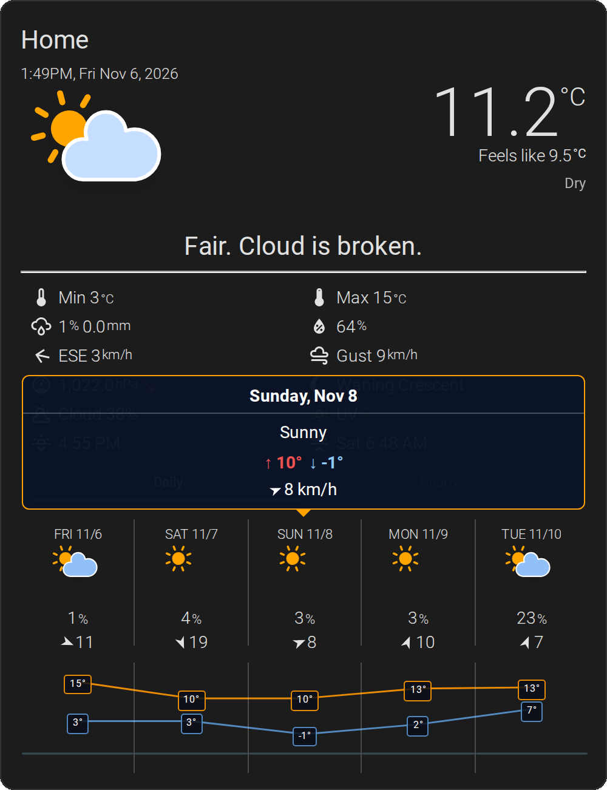
</p>

Two layout options: **Horizontal** (default, up to 5 days) and **Vertical** (up to 7 days).

<p align="center">
  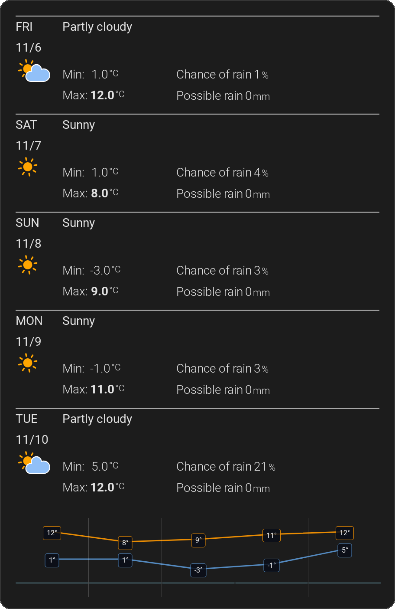
</p>

**Where the days come from.** Either a weather entity or per-day sensors:

- **A weather entity.** Set `weather_entity` and that is all there is to it. The six per-day settings in the table below (icon, summary, minimum, maximum, chance of rain, possible rain) are that entity, unless you set any of them yourself. Set one, to a sensor or to the weather entity, and the card fills in none of the others.
- **Per-day sensors**, the way the original Platinum Weather Card was configured. Set `entity_forecast_icon_1` and its siblings to the first sensor of a numbered series, such as `sensor.forecast_icon_1`, and the card steps the number up for each day.

`forecast_type` is `daily` (the default) or `twice_daily`. An `hourly` in an existing configuration is read as `daily`: the strip needs one forecast entry for each day, and the hours have a section of their own. With `twice_daily` (the National Weather Service gives only that and `hourly`) each date has a day entry and a night entry, told apart by Home Assistant's `is_daytime`: the day's icon, high and chance of rain are the day's, and the low is the night's.

The days can share the section with an hourly view, shown as a second tab or on its own. It has settings of its own, described under [Hourly Forecast Section](#hourly-forecast-section).

Hovering over any forecast day column shows a tooltip with date, weather description, max/min temperatures, precipitation, and wind speed/direction. The tooltip content is identical to the Charts section tooltip.

| Option | Type | Description |
| ------ | ---- | ----------- |
| Weather Entity with Forecasts | String | Main weather entity for forecast data |
| Forecast Type | String | `daily` or `twice_daily` (an existing `hourly` is read as `daily`) |
| Entity Forecast Icon 1 | String | Entity for forecast condition icon |
| Entity Forecast Summary 1 | String | Entity for forecast summary text (also used in hover tooltips) |
| Entity Forecast Min 1 | String | Forecast minimum temperature |
| Entity Forecast Max 1 | String | Forecast maximum temperature |
| Entity Forecast Chance of Rain 1 | String | Precipitation probability |
| Entity Forecast Possible Rain 1 | String | Estimated rainfall amount |
| Entity Extended Forecast 1 | String | Detailed forecast text (vertical only) |
| Entity Fire Danger 1 | String | Fire danger forecast (vertical only) |
| Include Today in Forecast | Boolean | Start the strip from today instead of tomorrow |
| Show date next to day | Boolean | Locale-formatted date after the day name (day label font shrinks to fit) |
| Show forecast wind | Boolean | Wind speed/direction in each forecast column |

With **Show date next to day** enabled, the date follows the day name and the label shrinks to fit:

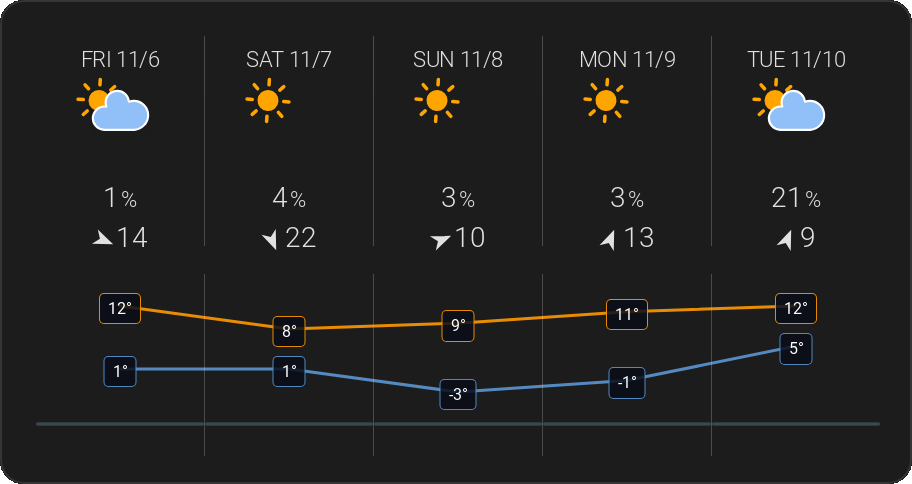

## Hourly Forecast Section

Hours and days answer different questions — *will I get wet walking home* against *is the weekend any good* — which is why the hours are a view of the forecast with settings of their own, rather than a second block of the card. They can sit beside the days as a second tab, or replace them.

### Turning it on

Two things are needed, and nothing changes until both are done:

1. **Set the Hourly weather entity**, a weather entity whose provider publishes hourly forecasts.
2. **Switch the Hourly forecast row on.** It is off by default.

In the editor the row is called **Hourly forecast** and sits directly beneath **Daily forecast** in the section list, with a clock icon. It has a switch and one settings button, which holds both the entity and the options, and no reorder arrows: it is a view of the forecast rather than a section of the card, so it stays beneath the daily forecast wherever that is moved.

The Hourly forecast switch and the Daily forecast switch together give the three useful arrangements, without a setting for it:

| Daily forecast | Hourly forecast | Shows |
| --- | --- | --- |
| on | off | days only |
| on | on | both, with a pair of tabs — **Daily** and **Hourly** — the way Home Assistant's own more-info dialog does it |
| off | on | hours only |

Both off shows nothing, which is what it ought to do. The Hourly forecast switch has no effect while no hourly entity is set: the card behaves as though it were off. The tabs appear once the hourly data has arrived.

### Settings

Opened with the settings button on the **Hourly forecast** row:

<p align="center">
  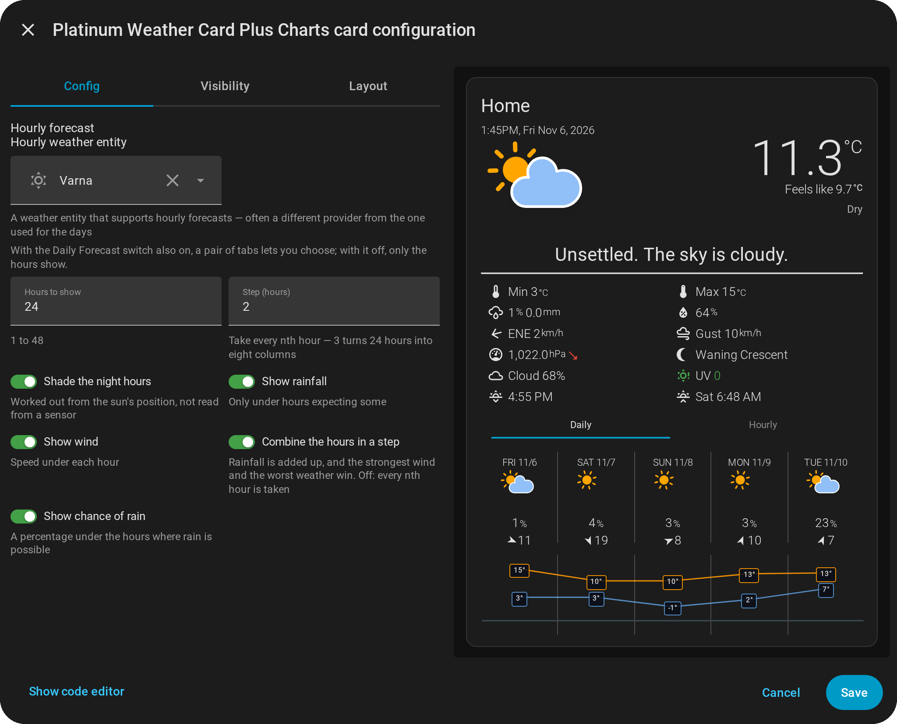
</p>

| Setting | Key | Default | |
| --- | --- | --- | --- |
| Hourly forecast (the row's switch) | `show_section_hourly_forecast` | off | Show the hourly view. Needs an hourly entity |
| Hourly weather entity | `entity_hourly` | none | The weather entity the hours come from |
| Hours to show | `hourly_forecast_hours` | `12` | 1 to 48; anything above 48 is capped at 48 |
| Step (hours) | `hourly_forecast_step` | `1` | Take every nth hour. The span is cut first and then thinned, so 24 hours at a step of 3 is eight columns and 48 hours is sixteen. The first column is always kept, since it is the hour you are standing in |
| Combine the hours in a step | `option_hourly_group` | off | With a step above 1, the hours in each step are combined instead of every nth one being taken: the rain is added up, the wind is the strongest, the weather is the worst of them, and the time and the temperature are those of the hour the step starts on. Without it, the rain that falls in the hours that are skipped is not shown |
| Shade the night hours | `option_hourly_shade_night` | on | A faint wash behind the hours the sun is down, so it is obvious where the day ends |
| Show rainfall | `option_hourly_precipitation` | on | A figure under the hours expecting some; the row vanishes when the whole span is dry, rather than printing a column of zeroes |
| Show chance of rain | `option_hourly_pop` | on | A percentage under the hours where rain is possible, in the colour of the rain; the row vanishes when the whole span is dry or the provider gives none. For grouped hours, the highest of the group |
| Show wind | `option_hourly_wind` | off | Speed under each hour, in the unit the hourly entity reports |

### What it shows

<p align="center">
  
</p>

A column per hour — time in the card's locale, icon, temperature — starting at the hour in progress. Temperatures follow the same decimals setting as the overview (`option_today_temperature_decimals`). The columns scroll sideways, each keeping a minimum width, so the span stays readable rather than being squeezed across a phone.

The night shading is **calculated, not read**. A sun entity reports where the sun is now, and these are hours that have not happened yet, so the card works the elevation out from your latitude and longitude — using the standard −0.833° horizon, which accounts for refraction and the sun's own width and is what "sunrise" actually means.

It is a **separate weather entity** rather than a second forecast type on the one used for the days, and that is deliberate. Most people already run more than one provider, and the one that is better at hours is often not the one they prefer for days: Met.no publishes forty-eight hours, needs no API key and works anywhere, which makes it a common second source even for people whose daily forecast comes from elsewhere. The card subscribes to the two independently.

Two things follow from having both. The temperature and precipitation charts belong to the days, so they are hidden while the hourly view is open — two unlabelled charts of different things, stacked, would be worse than one. And which tab is open is not written to the dashboard: it is a glance rather than a preference, and saving it on every tap would be both surprising and slow.

### Example

```yaml
show_section_hourly_forecast: true
entity_hourly: weather.forecast_home
hourly_forecast_hours: 48
hourly_forecast_step: 3
option_hourly_wind: true
```

## Charts Section

An integrated chart rendered directly below the daily forecast, showing the same days as the forecast strip.

| Option | Type | Description |
| ------ | ---- | ----------- |
| Show Temperature Chart | Boolean | Show max/min temperature polylines |
| Show Precipitation Chart | Boolean | Show precipitation bars with mm labels |

The chart is drawn from the weather entity's daily forecast, the same subscription the forecast strip uses, so no additional entities are required. A card configured with per-day sensors (`entity_forecast_icon_1` and the like) and no weather entity draws its charts from those instead, over the same days as the strip: the temperature chart from `entity_forecast_max_1` and `entity_forecast_min_1`, the rain chart from `entity_pos_1`. A chart whose sensor isn't configured is left out rather than drawn as zeroes.

Hovering over any chart column shows the same tooltip as hovering over the corresponding forecast column.

### Forecast columns and the Charts section

When the **Charts section is disabled**, max/min temperature and precipitation are shown as text directly in each forecast column:

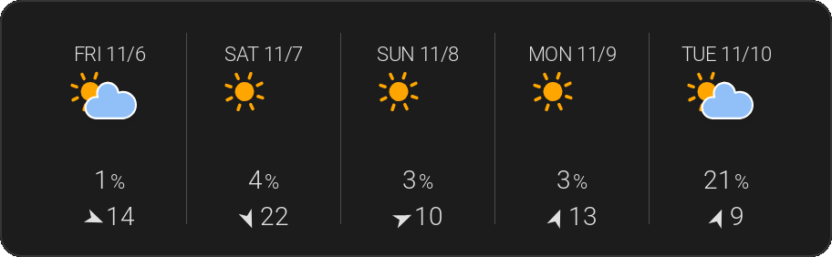

When the **Charts section is enabled**, the same data is rendered visually as temperature lines (max in orange, min in blue) and precipitation bars in the chart strip below the forecast. The text values are automatically hidden to avoid duplication — the chart already tells the full story.


The same five days either way. The whole card in each mode:

| Without charts | With charts |
|----------------|-------------|
| 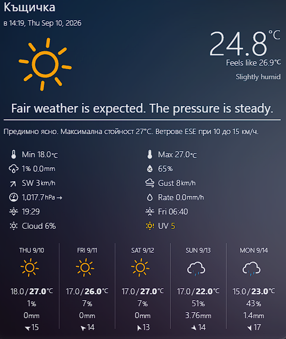 | 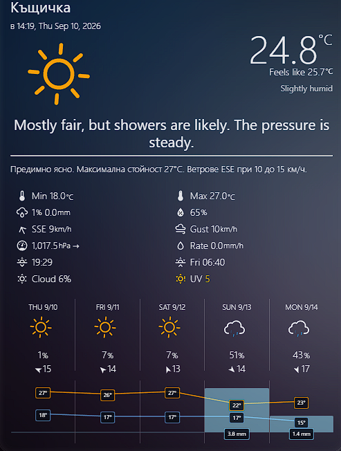 |

The two charts are independent, and each hides only its own row:

| | hides |
| --- | --- |
| `option_show_temperature_chart` | the max/min text in each column |
| `option_show_precipitation_chart` | the millimetre text in each column |

So a card with the precipitation chart on and the temperature chart off shows the temperatures as text and the rainfall as bars. If you would rather have the figures as well as the chart, switch off the chart you want the text for — there is no separate control for the text itself, since the pair are two views of one number.

The boxes of the values on the chart follow the mode of Home Assistant, so the card reads as well in a light theme as in a dark one:

<p align="center">
  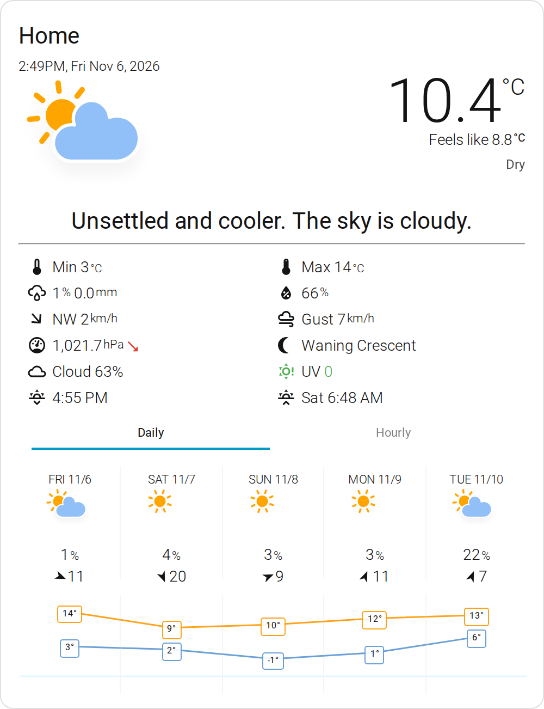
</p>

## Global Options

<p align="center">
  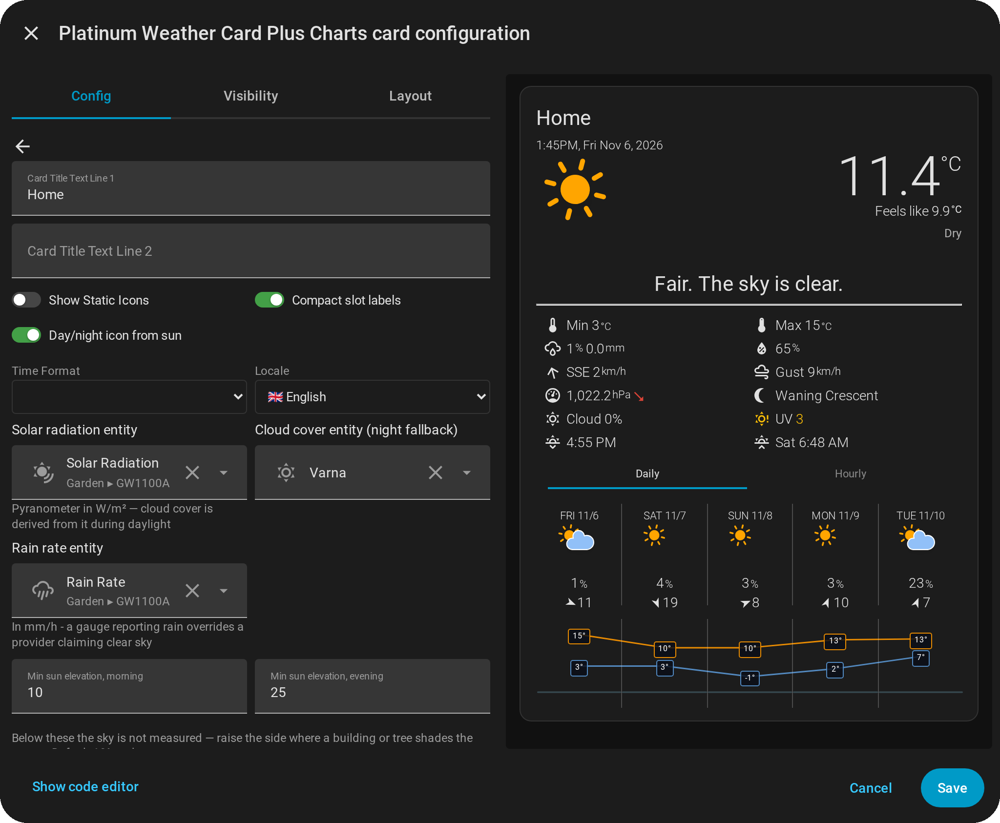
</p>

The lists of the pickers offer what each field can read: the solar radiation field offers the sensors in W/m², the temperatures the temperature sensors, and so on. **Offer every entity in the lists** turns that off.

<p align="center">
  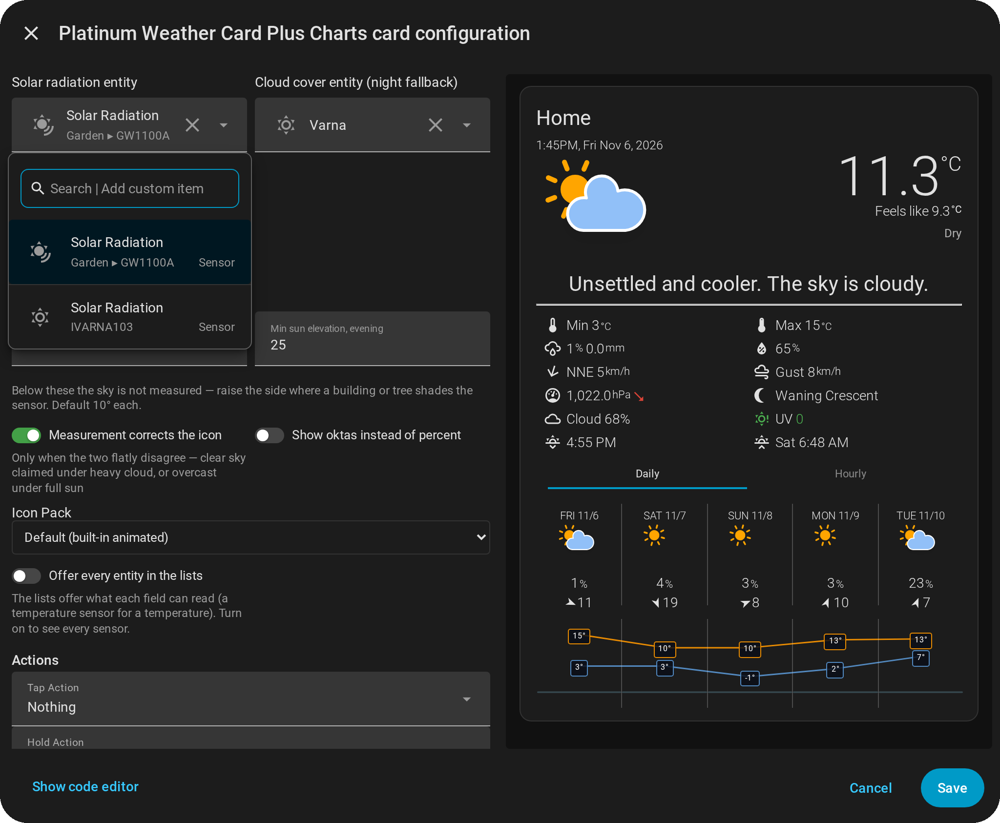
</p>

| Option | Type | Description |
| ------ | ---- | ----------- |
| Icon Pack | String | `default`, `photoreal`, `meteocons-fill`, `meteocons-line`, `ha-official`, `wcc-2`, or `custom` |
| Icon Pack Path | String | Path template for `custom` icon pack (e.g. `/local/icons/{condition}.svg`) |
| Show Static Icons | Boolean | Disable animated icons |
| Time Format | String | `system` (follows [Settings → Profile](https://my.home-assistant.io/redirect/profile/) in HA), `12hour`, or `24hour` |
| Locale | String | Locale for timestamp and moon phase formatting. Supported: `bg`, `cs`, `da`, `de`, `en`, `es`, `fr`, `he`, `it`, `nl`, `pl`, `ru`, `sr` (Cyrillic), `sr-Latn` (Latin), `ua` — when empty, the card follows the Home Assistant interface language |
| Compact slot labels | Boolean | Shorter slot label wording (`option_compact_slots`) |
| Show Gust in Wind Slot | Boolean | Append the gust value to the wind slot |
| Show Beaufort | Boolean | Prefix the wind slot with the Beaufort force |

---

# YAML Reference

Almost all settings can be configured in the GUI editor. The YAML reference below is for advanced use or bulk configuration. Access it via **Show Code Editor** in the card editor.

## Global Settings

| Variable | Type | Default | Description |
| -------- | ---- | ------- | ----------- |
| `type` | String | — | Must be `custom:platinum-weather-card-plus-charts` |
| `card_config_version` | Number | — | Written by the editor to record the configuration format it has already migrated. Leave it as it is |
| `section_order` | List | warnings, overview, extended, slots, daily_forecast, charts | Section display order. Left out, this is the order, in the card's own copy of the configuration |
| `show_section_overview` | Boolean | `true` | Show/hide overview section |
| `show_section_extended` | Boolean | `true` | Show/hide extended section |
| `show_section_slots` | Boolean | `true` | Show/hide slots section |
| `show_section_daily_forecast` | Boolean | `true` | Show/hide daily forecast section |
| `show_section_charts` | Boolean | `true` | Show/hide charts section |
| `tap_action` | Action | none | Action on tap |
| `hold_action` | Action | none | Action on hold |
| `double_tap_action` | Action | none | Action on double-tap |
| `option_static_icons` | Boolean | `false` | Use non-animated icons |
| `icon_pack` | String | `default` | Icon pack: `default`, `photoreal`, `meteocons-fill`, `meteocons-line`, `ha-official`, `wcc-2`, `custom` |
| `option_effects` | String | `off` | The weather behind the card (experimental): `off`, `subtle` or `full`. Clouds drift with the wind, rain and snow fall, stars come out at night, fog rolls in and a storm flashes. It is drawn from the icon the card has settled on, so a rain the gauge has ruled out is not shown. Set in the editor, under Appearance |
| `option_warning_style` | String | `soft` | The style of the warning rows: `soft` (a stripe that fades out, a small pill for a storm far away) or `classic` (the flat tinted bar) |
| `option_effects_area` | String | `overview` | Where it is drawn: behind the top part of the card (`overview`) or behind the whole card (`card`) |
| `icon_pack_path` | String | — | Path template for custom icon pack |

## Actions

The card supports all standard [HA actions](https://www.home-assistant.io/dashboards/actions/), configurable from **Global Options → Actions** in the editor:

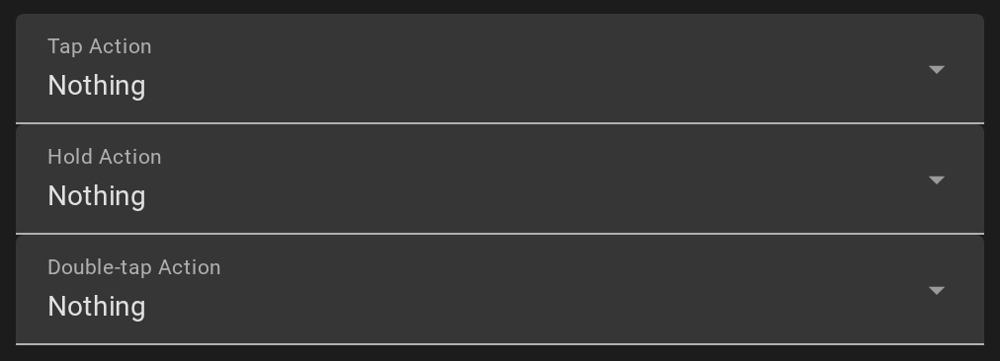

Some YAML examples:

```yaml
# Tap — show more-info for a specific entity
tap_action:
  action: more-info
entity: weather.my_weather

# Hold — navigate to another dashboard view
hold_action:
  action: navigate
  navigation_path: /lovelace/misc

# Double-tap — toggle a light
double_tap_action:
  action: call-service
  service: light.toggle
  target:
    entity_id: light.living_room
```

| `option_time_format` | String | `system` | `system` (follows [Settings → Profile](https://my.home-assistant.io/redirect/profile/) in HA), `12hour` or `24hour` |
| `option_locale` | String | none | Locale for timestamp and moon phase: `bg`, `cs`, `da`, `de`, `en`, `es`, `fr`, `he`, `it`, `nl`, `pl`, `ru`, `sr`, `sr-Latn`, `ua` |
| `text_update_time_prefix` | String | none | Prefix for the update time display |

## Overview Settings

| Variable | Type | Default | Description |
| -------- | ---- | ------- | ----------- |
| `overview_layout` | String | `complete` | `complete`, `observations`, `forecast` or `title only` |
| `option_show_overview_decimals` | Boolean | `false` | Show 1 decimal on current/apparent temperature |
| `option_show_overview_separator` | Boolean | `false` | Show separator below overview section |
| `text_card_title` | String | none | Title line 1 |
| `text_card_title_2` | String | none | Title line 2 |
| `entity_update_time` | String | none | Entity providing the update timestamp: a date and time (a sensor with the device class `timestamp`, or an attribute that holds one, with `update_time_use_attr`); a state that is not a date and time shows `---` |
| `update_time_use_attr` | Boolean | `false` | Use attribute for the timestamp |
| `update_time_name_attr` | String | none | Attribute name for the timestamp |
| `entity_temperature` | String | none | Current temperature entity |
| `entity_apparent_temp` | String | none | Apparent temperature entity |
| `entity_forecast_icon` | String | none | Forecast icon entity |
| `entity_summary` | String | none | Forecast summary entity |
| `forecast_text_alignment` | String | `center` | `left`, `center` or `right` for the condition text |
| `option_local_forecast` | Boolean | `false` | Compute a local Zambretti forecast and show it as the overview summary text (uses `entity_pressure`, `entity_pressure_trend`, `entity_wind_bearing`, `entity_wind_speed`) |
| `option_local_forecast_verbose` | Boolean | `false` | Full-sentence forecast text with a pressure-tendency clause |
| `option_forecast_altitude` | Number | none | Station altitude in meters — set only when the pressure sensor reports absolute pressure |
| `option_trend_window_hours` | Number | `3` | Time window of your pressure trend sensor, in hours — the tidal correction is averaged over it |
| `option_forecast_algorithm` | String | `zambretti` | `zambretti` or `sager` |
| `entity_wind_bearing_6h` | String | none | Wind bearing six hours ago, from a statistics helper — optional, sharpens one branch of Sager |
| `option_cloud_min_elevation_am` | Number | `10` | Sun elevation below which the sky is not measured, morning |
| `option_cloud_min_elevation_pm` | Number | `10` | The same for the evening, set separately for obstructions on one side |

## Extended Section

| Variable | Type | Default | Description |
| -------- | ---- | ------- | ----------- |
| `entity_extended` | String | none | Extended forecast entity |
| `extended_use_attr` | Boolean | `false` | Use attribute of the entity |
| `extended_name_attr` | String | none | Attribute name |
| `option_extended_separator` | Boolean | `true` | Put each source on its own line instead of running them together |
| `entity_todays_uv_forecast` | String | none | UV forecast entity |
| `entity_todays_fire_danger` | String | none | Fire danger entity |

## Slots Section

| Variable | Type | Default | Description |
| -------- | ---- | ------- | ----------- |
| `slot_l1`–`slot_l8` | Slot | see below | Left column slots 1–8 |
| `slot_r1`–`slot_r8` | Slot | see below | Right column slots 1–8 |
| `entity_pop` | String | none | Required for `pop`, `popforecast` |
| `entity_pos` | String | none | Required for `popforecast`, `possible_today` |
| `entity_possible_tomorrow` | String | none | Required for `possible_tomorrow` |
| `entity_rainfall` | String | none | Required for `rainfall` |
| `entity_humidity` | String | none | Required for `humidity` |
| `entity_pressure` | String | none | Required for `pressure` |
| `entity_pressure_trend` | String | none | Optional trend sensor — shows a colored ↗/→/↘ arrow next to the pressure value |
| `pressure_units` | String | none | Optional pressure unit label |
| `entity_observed_max` | String | none | Required for `observed_max`, `temp_maximums` |
| `entity_observed_min` | String | none | Required for `observed_min`, `temp_minimums` |
| `entity_forecast_max` | String | none | Required for `forecast_max`, `temp_maximums` |
| `entity_forecast_min` | String | none | Required for `forecast_min`, `temp_minimums` |
| `entity_temp_next` | String | none | Required for `temp_next` |
| `entity_temp_next_label` | String | none | Required for `temp_next` |
| `entity_temp_following` | String | none | Required for `temp_following` |
| `entity_temp_following_label` | String | none | Required for `temp_following` |
| `entity_uv_alert_summary` | String | none | Required for `uv_summary` |
| `entity_fire_danger` | String | none | Required for `fire_danger` |
| `entity_wind_bearing` | String | none | Required for `wind`, `wind_kt` |
| `entity_wind_speed` | String | none | Required for `wind`; wind speed unit is read automatically from the weather entity attributes |
| `entity_wind_gust` | String | none | Required for `wind` |
| `entity_wind_speed_kt` | String | none | Required for `wind_kt` |
| `entity_wind_gust_kt` | String | none | Required for `wind_kt` |
| `entity_visibility` | String | none | Required for `visibility` |
| `entity_sun` | String | `sun.sun` | Required for `sun_next`, `sun_following`; also decides day or night for the icon. Left out, it is `sun.sun` |
| `entity_moon` | String | none | Required for `moon` (HA Moon integration sensor) |
| `custom1_value`–`custom4_value` | String | none | Entity for custom slot |
| `custom1_icon`–`custom4_icon` | Icon | none | MDI icon for custom slot |
| `custom1_units`–`custom4_units` | String | none | Unit label for custom slot |
| `custom1_label`–`custom4_label` | String | none | Optional text label shown before the value |
| `option_today_temperature_decimals` | Boolean | `false` | 1 decimal on temperature slots |
| `option_today_rainfall_decimals` | Boolean | `false` | 1 decimal on rainfall slots |
| `option_forecast_decimals` | Boolean | `false` | 1 decimal on forecast temperatures |
| `option_show_forecast_pop` | Boolean | `true` | Show precipitation probability in forecast |
| `option_pressure_decimals` | Number | `0` | Decimal places for pressure: `0`–`3` |
| `option_wind_decimals` | Number | `0` | Decimals on wind speed and gust (0–2) — worth setting in m/s, where whole numbers are coarse |
| `option_color_fire_danger` | Boolean | `true` | Colour fire danger by severity |
| `option_wind_bearing_icon` | Boolean | `false` | Show the wind bearing as a rotating arrow icon instead of compass text |
| `option_compact_slots` | Boolean | `false` | Shorter slot label wording (Max, Min, ...) |
| `option_sun_overrides_icon` | Boolean | `true` | Force the day/night variant of the current condition icon from the sun entity's state (its elevation as a fallback), overriding the provider |
| `option_moon_icon_only` | Boolean | `false` | Show only the moon phase icon, without the text |
| `entity_solar_radiation` | String | none | Pyranometer in W/m², for the cloud cover slot |
| `entity_cloud_cover` | String | none | Provider cloud cover, used at night when the pyranometer cannot help: by the cloud cover slot and by the Sager forecast. A sensor in per cent, or a weather entity that gives `cloud_coverage` (met.no does); the picker offers only those: a weather entity that gives a cloud cover, and the sensors in per cent that are named for a sky (cloud, overcast, sky, облачност, bewölkung...), or every sensor in per cent when the house has none; anything else can be typed in |
| `entity_rain_rate` | String | none | Rain gauge in mm/h — measured rain overrides a provider reporting clear sky, and drives the rain rate slot. Intensity follows the standard bands: light below 2.5 mm/h, moderate to 10, heavy to 50, violent above |
| `entity_dew_point` | String | none | Dew point sensor, for the comfort line under the apparent temperature |
| `option_show_comfort` | Boolean | `false` | Show how the air feels, in a word |
| `entity_uv_index` | String | none | UV index sensor for the UV index slot |
| `option_cloud_cover_oktas` | Boolean | `false` | Show oktas instead of a percentage |
| `option_cloud_overrides_icon` | Boolean | `false` | Let the measured cloud cover and rain rate correct the condition icon |
| `option_slot_tap_more_info` | Boolean | `true` | Tap on a slot value opens the more-info history dialog |
| `entity_warning` | String | none | MeteoAlarm-compatible binary sensor for the warnings section |
| `entity_lightning_distance` | String | none | Strike detector distance sensor — adds its own warning row |
| `entity_lightning_azimuth` | String | none | Strike detector bearing sensor, for the direction |
| `option_lightning_max_distance` | Number | `50` | Storms further away than this are ignored |
| `show_section_warnings` | Boolean | `true` | Show the warnings section |
| `option_warning_show_expiry` | Boolean | `true` | Show when the warning expires |
| `option_show_gust_in_wind` | Boolean | `true` | Append the wind gust to the wind slot, e.g. "SE 12 (Gust 20) km/h" |
| `option_show_beaufort` | Boolean | `false` | Prefix the wind slot with the Beaufort force, e.g. "BFT: 4 - SE 12 km/h" |

Default slot values: l1=`forecast_max`, l2=`forecast_min`, l3=`wind`, l4=`pressure`, l5=`sun_next`, l6–l8=`remove`, r1=`popforecast`, r2=`humidity`, r3=`uv_summary`, r4=`moon`, r5=`sun_following`, r6–r8=`remove`.

A slot that you did not choose, and that has nothing to read, is not drawn, and not a row of `---`: the wind, the pressure and the humidity when the weather entity does not give them (and no entity of their own is set), the UV summary when `entity_uv_alert_summary` is not set, the chance of rain when the forecast gives neither a chance nor an amount, as the moon, which was not drawn without its entity, and the sun without `entity_sun`. A slot that you choose is always drawn, with `---` when it finds nothing; and so is one whose entity you set, while it is unavailable.

## Daily Forecast Section

| Variable | Type | Default | Description |
| -------- | ---- | ------- | ----------- |
| `weather_entity` | String | — | Main weather entity. On its own it is enough: unless you set any of the six `entity_*_1` keys, they are this entity, and unless you set any of `entity_forecast_icon`, `entity_temperature`, `entity_apparent_temp`, `entity_humidity`, `entity_pressure`, `entity_visibility`, `entity_wind_bearing`, `entity_wind_speed`, `entity_wind_gust`, `entity_uv_index`, `entity_dew_point`, `entity_forecast_min`, `entity_forecast_max`, `entity_pop` or `entity_pos` to an entity other than this one, those are too, and so is `entity_cloud_cover` |
| `forecast_type` | String | `daily` | `daily` or `twice_daily`. An existing `hourly` is read as `daily`: the strip needs one entry for each day |
| `daily_forecast_layout` | String | `horizontal` | `horizontal` or `vertical` |
| `daily_forecast_days` | Number | `5` | Days to show: 1–5 (horizontal), 1–7 (vertical) |
| `option_tooltips` | Boolean | `false` | Enable hover tooltips on horizontal forecast columns |
| `option_show_current_day` | Boolean | `false` | Include today in forecast strip |
| `option_daily_forecast_date` | Boolean | `false` | Show a locale-formatted date (e.g. 13.07) next to the day name |
| `option_show_forecast_wind` | Boolean | `false` | Show forecast wind speed/direction in each column |
| `entity_forecast_icon_1` | String | none | Condition icon for day 1: a weather entity, or the first of a numbered series of sensors (auto-incremented for each day). Unless you set any of the six `entity_*_1` keys, they are `weather_entity` |
| `entity_forecast_min_1` | String | none | Minimum temperature for day 1 (auto-incremented for each day) |
| `entity_forecast_max_1` | String | none | Maximum temperature for day 1 (auto-incremented for each day) |
| `entity_pop_1` | String | none | Chance of rain for day 1 (auto-incremented for each day) |
| `entity_pos_1` | String | none | Possible amount of rain for day 1 (auto-incremented for each day) |
| `entity_summary_1` | String | none | Weather summary for day 1, also used in the hover tooltip (auto-incremented for each day) |
| `entity_fire_danger_1` | String | none | Fire danger for day 1, vertical layout only (auto-incremented for each day) |
| `entity_extended_1` | String | none | Extended forecast text for day 1, vertical layout (auto-incremented for each day) |
| `daily_extended_use_attr` | Boolean | `false` | Read the extended forecast text from an attribute of `entity_extended_1` instead of its state |
| `daily_extended_name_attr` | String | none | Name of that attribute |
| `daily_extended_forecast_days` | Number | `7` | Extended forecast days (vertical only, 0–7) |
| `option_daily_color_fire_danger` | Boolean | `true` | Colour fire danger (vertical only) |
| `old_daily_format` | Boolean | `false` | Stack max/min vertically instead of side by side |
| `tempformat` | String | — | `highlow` = show max before min |

## Hourly Forecast Section

| Variable | Type | Default | Description |
| -------- | ---- | ------- | ----------- |
| `show_section_hourly_forecast` | Boolean | `false` | Show the hourly view. Has no effect until `entity_hourly` is set; together with `show_section_daily_forecast` it gives days only, both with tabs, or hours only |
| `entity_hourly` | String | none | Weather entity whose provider publishes hourly forecasts |
| `hourly_forecast_hours` | Number | `12` | Hours to show, 1 to 48 |
| `hourly_forecast_step` | Number | `1` | Take every nth hour — 24 hours at 3 is eight columns |
| `option_hourly_group` | Boolean | `false` | Combine the hours in each `hourly_forecast_step` (rain added up, strongest wind, worst weather) instead of taking every nth hour |
| `option_hourly_shade_night` | Boolean | `true` | Shade the hours the sun is down; calculated from `latitude`/`longitude`, not read from a sensor |
| `option_hourly_precipitation` | Boolean | `true` | Rainfall under the hours expecting some |
| `option_hourly_pop` | Boolean | `true` | The chance of rain under the hours that have one |
| `option_editor_all_entities` | Boolean | `false` | Editor only: offer every entity in the lists of the pickers that offer what a field can read, instead of what it can read |
| `option_hourly_wind` | Boolean | `false` | Wind speed under each hour, in the hourly entity's unit |

## Charts Section

| Variable | Type | Default | Description |
| -------- | ---- | ------- | ----------- |
| `option_show_temperature_chart` | Boolean | `false` | Show max/min temperature lines. Hides the max/min text in the forecast columns while on |
| `option_show_precipitation_chart` | Boolean | `false` | Show precipitation bars. Hides the millimetre text in the forecast columns while on |

The chart uses the same `weather_entity` and `daily_forecast_days` settings as the Daily Forecast section. No additional entities are required.

[license-shield]: https://img.shields.io/github/license/rudizl/platinum-weather-card-plus-charts.svg?style=flat
[releases-shield]: https://img.shields.io/github/v/release/rudizl/platinum-weather-card-plus-charts?style=flat
[releases]: https://github.com/rudizl/platinum-weather-card-plus-charts/releases
